# CHITKALA on AWS — Cloud Architecture & Design

> **What this is:** the AWS realisation of the *optional* cloud services described in
> [`../CHITKALA_TECHNICAL_DESIGN.md`](../CHITKALA_TECHNICAL_DESIGN.md) (the "TDD"): identity, model relay, hosted
> index, cloud agent runs, managed publishing, encrypted sync and (later) real-time collaboration.
>
> **What this is not:** a move of CHITKALA into the cloud. The desktop app and the user's Markdown vault stay
> canonical and complete on their own. Every service here is opt-in, has a local substitute, and **never writes to the
> vault** (TDD §1.4, §5.5, ADR-002, ADR-005).
>
> **Status:** proposed design; nothing here is implemented. Service capabilities were checked against public AWS
> documentation as of the date above. Quotas, prices and Region availability must be re-validated during the spikes in
> [§20](#20-open-questions--spikes).

**Diagrams:** every picture below is generated from [`diagrams/arch_specs.py`](diagrams/arch_specs.py) with the
Marvellous AWS Architectures Docs engine (vendored in `diagrams/tools/`). Open
[`architecture/index.html`](architecture/index.html) to play each flow step by step and build the overview up milestone
by milestone; editable draw.io files are in [`architecture/drawio/`](architecture/drawio/). Rebuild with
`diagrams/build.sh`.

---

## Contents

1. [Design position](#1-design-position)
2. [Invariants carried into the cloud](#2-invariants-carried-into-the-cloud)
3. [What runs where](#3-what-runs-where)
4. [Architecture overview](#4-architecture-overview)
5. [Service selection](#5-service-selection)
6. [Identity, tenancy and accounts](#6-identity-tenancy-and-accounts)
7. [Data architecture](#7-data-architecture)
8. [Encrypted personal sync (M5)](#8-encrypted-personal-sync-m5)
9. [Grounded intelligence (M2–M3)](#9-grounded-intelligence-m2m3)
10. [Cloud agent runs (M4)](#10-cloud-agent-runs-m4)
11. [Managed publishing (M4)](#11-managed-publishing-m4)
12. [Real-time collaboration (Later)](#12-real-time-collaboration-later)
13. [API surface on AWS](#13-api-surface-on-aws)
14. [Security architecture](#14-security-architecture)
15. [Observability](#15-observability)
16. [Resilience, backup and DR](#16-resilience-backup-and-dr)
17. [Cost model](#17-cost-model)
18. [Delivery, environments and IaC](#18-delivery-environments-and-iac)
19. [AWS architecture decision records](#19-aws-architecture-decision-records)
20. [Open questions & spikes](#20-open-questions--spikes)
21. [Traceability to the TDD](#21-traceability-to-the-tdd)

---

## 1. Design position

CHITKALA's thesis is *own the files, connect the ideas, delegate the work, verify the results*. The cloud can help
with four things a single desktop cannot do well on its own:

| Need | Why a desktop alone falls short | Cloud service (this doc) |
|---|---|---|
| Bigger models than the laptop runs | Local models are optional and limited | **Model relay** to Amazon Bedrock (§9) |
| Long or scheduled agent work | The laptop sleeps, closes, goes offline | **Cloud agent runs** on Step Functions (§10) |
| Knowledge on more than one device | Files need a safe meeting point | **Encrypted sync** on S3 + DynamoDB (§8) |
| Sharing with the world | Static hosting, TLS, CDN | **Managed publishing** on CodeBuild + CloudFront (§11) |

And two later conveniences: a **hosted index** for a browser companion (§9.3) and **live collaboration** (§12).

The governing rules:

1. **Local-first is the product.** Turn off the network and everything in M0–M1 still works (TDD G10, NFR "Offline readiness").
2. **The cloud proposes; the desktop commits.** Agent output arrives as a patch proposal. Only the desktop's trusted
   core writes the vault, with a revision compare-and-swap (TDD §10.8).
3. **Consent decides what leaves the device.** A vault's provider policy (`local-only`, `external-models-with-consent`,
   `selected-folders-only`, TDD §17.3) is enforced *on the device before upload* and *again in the cloud*.
4. **Sync is end-to-end encrypted; intelligence is consented plaintext.** The two never share a store. A vault can
   use sync without ever exposing plaintext; hosted intelligence only sees folders the user explicitly releases.
5. **Serverless and scale-to-zero by default.** A free, open-source project cannot carry idle clusters. Every service
   chosen bills per request or scales to zero, except where a stateful connection forces otherwise (§12).
6. **Modular monolith in the cloud too** (TDD §5.5, ADR-010): one API codebase, deployed as a few Lambda functions
   grouped by blast radius, not a fleet of microservices.

---

## 2. Invariants carried into the cloud

Each non-negotiable from the TDD and `CODE_ASSIST_HANDOFF.md`, and how AWS enforces it.

| # | Invariant (TDD) | Cloud enforcement |
|---|---|---|
| I1 | Markdown files are canonical (ADR-002) | No AWS store is authoritative for document bodies. Sync S3 is a ciphertext *replica*; Aurora is a *projection*. Deleting the whole AWS footprint loses no knowledge. |
| I2 | Agent writes are reviewable patches (ADR-005) | Step Functions ends a run in `WAITING_REVIEW` with a task token. No IAM role in the cloud can write to a device. Commit happens on the desktop with `baseRevision` CAS (§10). |
| I3 | Untrusted code never runs with privilege (ADR-006) | MDX/Astro builds run in CodeBuild with no vault, sync or model access; agent code tools run in Fargate with no egress (§10.4, §11). |
| I4 | Indexes are rebuildable | Aurora and embeddings are rebuilt from the consented corpus; the corpus is re-uploadable from the vault. No backups of Aurora are required for correctness (only for recovery time). |
| I5 | Privacy scopes apply before model context | Desktop filters before upload; the relay re-checks consent mode and folder scopes in DynamoDB; Aurora row-level security filters by tenant *and* scope before ranking (§9). |
| I6 | Citations are machine-verifiable | Hosted chunks keep `document_id + revision + span + content_hash`. The model may cite only chunk ids it received; a verifier rejects others (§9.4). |
| I7 | Public export uses an explicit allowlist (ADR-011) | Only the allowlisted bundle is uploaded; the cloud build re-validates; Macie scans before promotion (§11). |
| I8 | Sync ≠ collaboration (ADR-008) | Separate services, buckets and tables (§8 vs §12). |
| I9 | No unconsented telemetry | CloudWatch receives operational metrics and correlation ids only. Prompt and document text are never logged (§15). |
| I10 | No paid dependency is required | Every feature in §3 has a free local path; AWS is an operator choice (self-host via the CDK app, or a future managed service). |

---

## 3. What runs where

| Capability | Local (always available) | AWS (opt-in) | Never in AWS |
|---|---|---|---|
| Editing, preview, backlinks, graph, FTS5 | ✅ Tauri + SQLite | — | — |
| Embeddings / semantic search | Local model or BYO key | Bedrock embeddings; Aurora pgvector for hosted index | Unconsented folders |
| Q&A / writing assistance | Local model | Model relay → Bedrock | Raw vault upload |
| Agent runs | Desktop runtime (default) | Step Functions (long / scheduled) | Direct vault writes |
| Publishing | Local Astro build → folder / GitHub Pages | CodeBuild → S3 → CloudFront | Private notes, private transclusions |
| Sync | Git / WebDAV / user's own S3 adapter | Managed E2EE relay (S3 + DynamoDB) | Plaintext, vault keys |
| Collaboration | — | ECS Fargate Yjs relay (Later) | Plaintext CRDT state |
| Secrets / keys | OS keychain | KMS (server-side layer only) | Vault encryption keys |
| Telemetry | Local traces | Opt-in metrics in CloudWatch | Prompts, document bodies |

---

## 4. Architecture overview

**Reading the picture.** The user's devices sit *outside* the AWS boundary because the vault lives there. Numbers are
the order things happen; the stage chips in `architecture/index.html` (M0 → M5) show what exists after each milestone.
Network detail (VPCs, endpoints) is in the zoom-ins.

| Stage | Milestone | Adds | Stage map |
|---|---|---|---|
| 0 | M0–M1 | Desktop and vault only. **No AWS at all.** | [`stage-00`](architecture/svg/chitkala-aws-overview-stage-00.svg) |
| 1 | M2 prerequisite | Cognito, API Gateway, API Lambdas, DynamoDB, KMS, CloudWatch | [`stage-01`](architecture/svg/chitkala-aws-overview-stage-01.svg) |
| 2 | M2 | Model relay + Bedrock | [`stage-02`](architecture/svg/chitkala-aws-overview-stage-02.svg) |
| 3 | M3 | Hosted index: SQS → indexer → Aurora | [`stage-03`](architecture/svg/chitkala-aws-overview-stage-03.svg) |
| 4 | M4 | Step Functions agent runs + Fargate sandbox | [`stage-04`](architecture/svg/chitkala-aws-overview-stage-04.svg) |
| 5 | M4 | Publishing: S3 + CodeBuild + CloudFront | [`stage-05`](architecture/svg/chitkala-aws-overview-stage-05.svg) |
| 6 | M5 | Encrypted sync to other devices | [`stage-06`](architecture/svg/chitkala-aws-overview-stage-06.svg) |

### 4.1 Step walk-through

1. The author works fully offline; the vault on disk is canonical.
2. Opting in, the author signs in; Cognito registers the device and issues short-lived JWTs.
3. The desktop calls `/v1` through API Gateway with the JWT; AWS WAF filters abuse.
4. API Lambdas re-check every capability grant with the same rules as the desktop's policy broker.
5. Tenant-scoped records (devices, grants, runs, audit index, sync ledger) live in DynamoDB.
6. Each tenant's data is encrypted under its own KMS key.
7. Key use is logged in CloudTrail; metrics and traces carry correlation ids, never document bodies or prompts.
8. For a grounded question, the desktop retrieves locally and sends only the scope-filtered context to the relay.
9. Bedrock answers through Guardrails; the answer may cite only the chunk ids it was given.
10. For the web companion, consented folders are queued for hosted indexing.
11. The indexer chunks by heading and requests embeddings, recording model and version.
12. Chunks, vectors, full-text fields and link edges are written to Aurora with row-level security.
13. Hosted questions use hybrid retrieval from Aurora before the model call.
14. A long-running or scheduled skill starts a Step Functions agent run with its grants and budgets.
15. Planner and writer steps call Bedrock within the run's budget.
16. Tools run in an isolated Fargate task with no internet.
17. The run ends as a patch proposal pushed to the desktop over WebSocket.
18. The author reviews and approves; the desktop commits locally (CAS) and the run resumes.
19. To publish, only allowlisted, sanitized files are uploaded as a bundle.
20. An isolated CodeBuild project builds the Astro site and re-runs privacy, link and CSP checks.
21. After preview approval, CloudFront switches to that build; rollback is a pointer switch.
22. Readers get the public-only site, search index and graph.
23. Sync: the desktop encrypts committed revisions and uploads content-addressed ciphertext.
24. Other devices are notified, fetch, verify, decrypt and reconcile locally.

---

## 5. Service selection

| Capability | AWS choice | Local substitute | Alternatives considered | Why this choice |
|---|---|---|---|---|
| Identity | **Amazon Cognito** user pools (+ device records in DynamoDB) | None needed (no account) | IAM Identity Center (workforce, not consumers); self-hosted Keycloak | Managed consumer identity, OIDC/JWT, MFA, passkeys, social federation; pay per MAU |
| Public API | **API Gateway HTTP API** (REST `/v1`) | Tauri IPC | REST API (more features, higher price); ALB | JWT authorizer built in; cheap; Lambda proxy |
| Push channel | **API Gateway WebSocket API** | Local event emitter | AppSync Events; IoT Core | One connection per device for run events and sync notices; pay per message/minute |
| Business logic | **AWS Lambda** (Node.js/TypeScript or Rust) | Rust core | ECS services | Scale to zero; matches modular-monolith with per-domain functions |
| Control data | **Amazon DynamoDB** (on-demand) | SQLite | Aurora for everything | Conditional writes give CAS for the sync head and idempotency keys; Streams drive notifications; zero idle cost |
| Hosted index | **Aurora PostgreSQL Serverless v2** with `pgvector`, `tsvector`, edge tables, RLS | SQLite FTS5 + sqlite-vec | OpenSearch Serverless; Amazon S3 Vectors; Kendra | One engine mirrors the local design (FTS + vectors + relational graph), RLS for tenants, scales to zero (minimum 0 ACU, resume latency to be measured). Revisit S3 Vectors for very large, cold corpora |
| Models | **Amazon Bedrock** (Converse API, embeddings, rerank, Guardrails) | Ollama-compatible local endpoint | Direct third-party APIs via relay | Provider-neutral surface (ADR-012), IAM-native, no keys on devices, Guardrails for prompt-attack and PII filtering |
| Agent orchestration | **AWS Step Functions** (Standard workflows) | Desktop state machine | Bedrock AgentCore Runtime; LangGraph on ECS | The TDD's run state machine maps 1:1 to states; `waitForTaskToken` models human review; durable up to a year; execution names give idempotency |
| Tool sandbox | **ECS on AWS Fargate** in isolated subnets | OS sandbox on desktop | Lambda; Bedrock AgentCore Code Interpreter | Per-task isolation (Firecracker), no egress, read-only root FS, CPU/memory caps. AgentCore Code Interpreter is a candidate in spike S6 |
| Queues | **Amazon SQS** (+ DLQ) | In-process queue | EventBridge Pipes | Back-pressure for indexing; simple retries |
| Object storage | **Amazon S3** (sync, corpus, publish, audit) | Filesystem | EFS | Conditional writes (`If-None-Match`, `If-Match`), versioning, Object Lock, lifecycle |
| Site build | **AWS CodeBuild** in VPC, no NAT | Local Astro worker | Fargate task | Ephemeral, per-build isolation, pinned image from ECR |
| CDN | **Amazon CloudFront** + KeyValueStore + Functions, OAC to S3, response-headers policy for CSP | GitHub Pages / any static host | Amplify Hosting | Atomic promote/rollback by pointer; per-site CSP; WAF integration |
| Sensitive-data scan | **Amazon Macie** on the publish bucket | Local publish checks | Custom regex only | Second, independent check before anything goes public |
| Collaboration | **ECS Fargate** Yjs relay behind **ALB**, **ElastiCache** pub/sub | — | API Gateway WebSocket (stateless, poor fit for CRDT rooms) | Long-lived rooms need a stateful process |
| Keys | **AWS KMS** (customer-managed key per tenant tier) | OS keychain | — | Server-side encryption, key policies, CloudTrail on every use |
| Secrets | **AWS Secrets Manager** | OS keychain | Parameter Store | Only for platform secrets (e.g. third-party provider keys if a relay adapter ever needs one) |
| IaC | **AWS CDK** (TypeScript) | — | Terraform | Same language as the app; constructs for every service above |

---

## 6. Identity, tenancy and accounts

### 6.1 Principals

| Principal | Represented as | Credential |
|---|---|---|
| Person | Cognito user (`sub`) | Password/passkey + optional MFA → ID/access JWT (1 h) + refresh token in OS keychain |
| Device | DynamoDB `DEVICE#<id>` under the user, public key for sync key-wrapping | JWT plus device id claim; revocable |
| Skill / agent | `skill:<id>@<version>` principal in grants (TDD §10.7) | No credential: acts only through a run's grants |
| Service | IAM role per Lambda / task | Short-lived STS credentials |

### 6.2 Tenancy

- **Tenant = personal workspace** (one user) in M2–M5; **organisation** later (TDD §14.6).
- Every row and object key starts with the tenant id: DynamoDB `PK = TENANT#<t>#…`, S3 `t/<tenant>/…`, Aurora
  `tenant_id` column with RLS policy `tenant_id = current_setting('app.tenant_id')`.
- Lambdas assume a **tenant-scoped session**: `sts:AssumeRole` with session tag `tenant=<t>`; IAM policies use
  `aws:PrincipalTag/tenant` in `dynamodb:LeadingKeys` and S3 prefix conditions (ABAC). A bug in handler code therefore
  cannot read another tenant's items.
- **Capability grants** (TDD §10.7) are stored in DynamoDB and checked by the API *in addition to* IAM. IAM confines
  the tenant; grants confine the action and scope inside the tenant.

### 6.3 AWS accounts (AWS Organizations)

| Account | Contents |
|---|---|
| Management | Organizations, billing, SCPs only |
| Security | GuardDuty, Security Hub, IAM Access Analyzer (delegated admin) |
| Log archive | Organization CloudTrail, Config history (S3 Object Lock) |
| Tooling | GitHub OIDC deploy roles, ECR (builder and sandbox images), desktop release bucket + CloudFront |
| Staging | Full stack, synthetic tenants only |
| Production | Full stack |

SCPs: deny leaving the Organization, deny disabling CloudTrail/GuardDuty, restrict Regions, deny creating IAM users
with access keys.

---

## 7. Data architecture

### 7.1 Stores

| Store | Holds | Authoritative? | Encryption | Retention |
|---|---|---|---|---|
| Device vault | Markdown, assets, `.chitkala/` | **Yes** | User's disk | User |
| S3 `sync` | Ciphertext objects + encrypted manifests | Replica | Client E2EE + SSE-KMS | Versioned; noncurrent versions expire after 30 days (proposal) |
| DynamoDB `control` | Devices, grants, runs, run events, sync head, budgets, publish records | Yes for operational state | SSE-KMS | Run events: TTL 30 days; grants: until expiry |
| S3 `corpus` | Consented plaintext documents (hosted index) | Replica | SSE-KMS (tenant key) | Deleted on consent revoke |
| Aurora `index` | Chunks, FTS, vectors, entities, edges | Projection | Storage encryption (KMS) | Rebuildable |
| S3 `runs` | Context packs, proposals, run artefacts | Pack: no; proposal: until decided | SSE-KMS | Packs: deleted at run end + lifecycle 1 day backstop |
| S3 `audit` | Append-only run audit records | **Yes for audit** | SSE-KMS, Object Lock (governance) | Documented window, e.g. 1 year |
| S3 `publish` | Bundles, site builds | Build output | SSE-S3/KMS | Keep last N builds per site |

### 7.2 DynamoDB single-table design (`control`)

| Entity | PK | SK | Notes |
|---|---|---|---|
| Device | `TENANT#t` | `DEVICE#d` | public key, last seen, revoked flag |
| Vault | `TENANT#t` | `VAULT#v` | provider policy, consent scopes, sync enabled |
| Sync head | `VAULT#v` | `HEAD` | `seq`, manifest key, updatedBy; updated only with `ConditionExpression seq = :parent` |
| Sync commit | `VAULT#v` | `COMMIT#<seq>` | manifest ref, device, parent seq (history) |
| Grant | `TENANT#t` | `GRANT#g` | principal, action, resources, constraints, expiry (TTL) |
| Agent run | `TENANT#t` | `RUN#r` | state, skill, budgets, execution ARN, task token (encrypted) |
| Run event | `RUN#r` | `EVT#<seq>` | ordered events for SSE/WebSocket replay by cursor |
| Idempotency | `IDEM#<key>` | `IDEM` | request hash + response; TTL 24 h |
| Budget | `TENANT#t` | `BUDGET#<yyyy-mm>` | token counters updated with atomic `ADD` |
| Connection | `TENANT#t` | `CONN#<connId>` | WebSocket connection → device |
| Publication | `TENANT#t` | `SITE#s#BUILD#b` | manifest hash, build hash, status, receipt |

GSI1 (`GSI1PK = DEVICE#d`) finds a device's connections; GSI2 (`GSI2PK = STATE#<state>`) finds runs waiting for review
or expiring. Streams on `HEAD` items feed the sync notifier.

### 7.3 Aurora hosted-index schema

The schema mirrors `../schema.sql` so the same retrieval logic and tests apply:

| `schema.sql` table | Aurora table | Change |
|---|---|---|
| `documents`, `document_revisions` | same | `tenant_id`, `scope_id` added; RLS |
| `chunks` + `chunks_fts` (FTS5) | `chunks` with `tsv tsvector` + GIN index | FTS5 `bm25()` → `ts_rank_cd`; tokenizer choice is spike S3 |
| `embedding_records` | `chunk_embeddings(chunk_id, namespace, embedding vector(n))` + HNSW index | one namespace per model+version (TDD §9.3) |
| `entities`, `edges` | same | recursive CTE with hop limit for k-hop |
| `projection_watermarks` | same | per tenant + scope |
| `agent_runs`, `patch_proposals`, `capability_grants`, `audit_events`, `publications` | **not in Aurora** | live in DynamoDB / S3 (operational, not projection) |

---

## 8. Encrypted personal sync (M5)

### 8.1 Protocol

1. **Commit locally.** The device's journal produces a revision: `content_hash`, parent, device id, logical time.
2. **Encrypt locally.** Each changed file becomes an object encrypted with the **vault key** (AEAD, e.g.
   XChaCha20-Poly1305 via a vetted library; choice in spike S5). Object name = `sha256(ciphertext)`. File paths and
   names are inside the encrypted manifest, not in object keys.
3. **Push request.** `POST /v1/sync/vaults/{v}/push {parentSeq, objectHashes[]}` → the Sync API returns presigned PUT
   URLs for hashes the bucket lacks (`HeadObject` batch or a DynamoDB object index).
4. **Upload.** `PutObject` with `If-None-Match: *`: objects are immutable and naturally deduplicated.
5. **Commit.** `POST …/commit {parentSeq, manifestKey}` → DynamoDB `UpdateItem HEAD SET seq = parentSeq + 1 …
   ConditionExpression seq = :parentSeq`. Success → new head. Failure → `409 diverged`.
6. **Diverged.** The device pulls the newer manifests, runs the TDD §14.2 reconciliation locally (fast-forward,
   three-way merge, or named conflict copy) and retries. The server never merges.
7. **Notify.** DynamoDB Streams → notifier Lambda → WebSocket `post_to_connection` to the vault's other devices with
   `{vault, seq}` only.
8. **Pull.** Other devices fetch manifests and objects via presigned GETs, verify hashes, decrypt, reconcile, reindex.

### 8.2 Keys

| Key | Where it lives | Purpose |
|---|---|---|
| Vault key (random 256-bit) | Device keychains only | Encrypts objects and manifests |
| Device key pair | Device keychain (private), DynamoDB (public) | Wraps the vault key for each device |
| Wrapped vault keys | DynamoDB `VAULT#v / KEYWRAP#d` | Lets a new device get the vault key after approval by an existing device |
| Recovery key | Shown once to the user (printable) | Unwraps a recovery copy of the vault key |
| KMS tenant key | AWS KMS | Server-side encryption at rest (defence in depth only) |

**Device revocation** removes the device's wrap and rotates the vault key for new objects. Old objects remain readable
by anyone who held the old key; the UI states that rotation protects only future data (TDD §14.3: avoid marketing
claims). Metadata visible to AWS: object count, sizes, timing, device count.

### 8.3 Adapters

The same reconciliation engine supports a **bring-your-own S3** adapter (user's bucket, same object layout, uses S3
conditional writes for the head object instead of DynamoDB), Git and WebDAV (TDD §14.4). The managed service is a
convenience, not a lock-in.

---

## 9. Grounded intelligence (M2–M3)

### 9.1 Modes

| Mode | Who retrieves | What reaches AWS | Use |
|---|---|---|---|
| **Local-only** | Desktop | Nothing | Default |
| **Relay** (M2) | Desktop (FTS5 + vectors + graph) | Question + the consented chunks it chose, for one request | Bigger model, no hosted copy |
| **Hosted index** (M3) | Retriever Lambda on Aurora | Consented folders, stored and indexed | Web companion, scheduled agents, other devices without a local index |

The consent mode is a per-vault setting stored on the device and mirrored to DynamoDB; the relay refuses requests
whose vault is `local-only` or whose chunks come from scopes not in `selected-folders-only`.

### 9.2 Relay request path

1. Desktop builds the context (TDD §9.1 pipeline up to `GUARD`), redacts per user rules, and shows the consent preview
   (model, data categories, approximate size).
2. `POST /v1/model/converse` (streamed). The relay checks: JWT, vault consent, model allowlist, per-tenant monthly
   token budget (`UpdateItem ADD` with condition `used + estimate <= limit`).
3. Bedrock **Guardrails** run on input (prompt-attack filter on the *document* content, PII filters as configured).
4. Bedrock Converse is called with a model chosen by **family and fallback order** (configurable; not hard-coded).
5. The relay streams tokens back. Citations are chunk ids from the supplied context only; the relay drops any
   citation id it did not send.
6. The desktop's **citation verifier** resolves each id to `documentId + revision + span` and flags unsupported claims
   (TDD §9.5, §9.8).

Response streaming uses Lambda response streaming behind a Function URL fronted by CloudFront (with Origin Access
Control and WAF), because API Gateway HTTP APIs buffer responses. Non-streamed calls use the HTTP API.

### 9.3 Hosted index

- **Ingest:** the desktop uploads consented files to `s3://corpus/t/<tenant>/v/<vault>/…` (SSE-KMS tenant key). An S3
  event goes to SQS (DLQ after 5 attempts).
- **Index:** the indexer Lambda (in a VPC, private subnets, no NAT, endpoints for S3, SQS, Bedrock, KMS, Secrets
  Manager) parses Markdown with the **same TypeScript parser package** as the desktop (`packages/markdown`,
  `packages/retrieval`), chunks by heading (target 350–650 tokens, max 900, overlap 50 within a section), embeds with
  Bedrock, and upserts in one transaction. Idempotent by `(document_id, revision, projection)`.
- **Retrieve:** the retriever runs lexical (`tsvector`), vector (`pgvector` HNSW) and graph (edge CTE) channels
  separately under RLS, fuses them with **RRF**, optionally reranks with a Bedrock rerank model, applies the token
  budget, and hands the context to steps 3–6 above.
- **Revoke:** turning off consent for a folder deletes its corpus objects; an S3 delete event removes chunks,
  vectors, edges and any derived summaries (TDD §12.5 delete propagation). A nightly reconciler compares corpus keys
  with Aurora documents.
- **Embedding model change** → new namespace; progressive re-embedding; queries never mix namespaces.

### 9.4 Quality gates in the cloud

The TDD §9.7 retrieval benchmark runs in CI against the staging stack with a synthetic tenant: recall@k, nDCG@k,
citation exactness (≥ 95 %), zero fabricated ids, zero cross-scope leakage, p95 latency and token cost per question.
Results are stored per model and embedding version.

---

## 10. Cloud agent runs (M4)

Agents run **on the desktop by default**. The cloud runtime exists for runs that outlive a laptop session (long
research, scheduled curation, publishing previews).

### 10.1 State machine mapping

| TDD state (§10.3) | Step Functions |
|---|---|
| `CREATED` | Execution started; name = idempotency key |
| `PLANNED` | `Plan` task (Lambda → Bedrock) |
| `WAITING_PERMISSION` | `.waitForTaskToken` state when a tool needs a grant the run does not hold; the desktop is asked |
| `RUNNING` | `Map`/loop of `Step` tasks; each tool call → policy broker |
| `PROPOSAL_READY` | `Propose` task writes the patch to S3 |
| `WAITING_REVIEW` | `.waitForTaskToken` with `HeartbeatSeconds` and a timeout (e.g. 7 days) |
| `COMMITTING` | Happens **on the desktop**; the cloud waits |
| `COMPLETED` | `SendTaskSuccess` with the committed revision |
| `REJECTED` / `EXPIRED` / `CANCELLED` / `FAILED` | `SendTaskFailure`, timeout, `StopExecution`, catch blocks |

Every transition appends a run event (`agent.run.started`, `agent.plan.ready`, `agent.tool.requested`, …, TDD §13.5)
with a monotonic sequence number in DynamoDB; devices replay from a cursor after reconnecting.

### 10.2 Context

A cloud run can read only:

1. a **context pack** the desktop uploads for this run (only the documents in the run's `vault.read` scope, encrypted
   with the tenant key, deleted when the run reaches a terminal state, with a 1-day lifecycle backstop), or
2. the **hosted index** for scopes the user has consented to.

### 10.3 Policy broker

A Lambda that every tool call passes through. It validates the tool schema, checks the grant (principal + action +
resource + constraints + expiry), applies quotas and timeouts, records provenance, and marks tool output as
**untrusted data** before it reaches the model (TDD §10.6, OWASP MCP guidance). Natural-language text can never mint
a grant: grants are created only by the desktop on an explicit user action.

### 10.4 Tool execution

| Tool class | Runs in | Controls |
|---|---|---|
| Retrieval, graph, diagram render | Lambda | Read-only, tenant session tags |
| Code execution | ECS Fargate task, isolated subnet | No NAT or internet gateway; only VPC endpoints for S3 (run prefix) and CloudWatch Logs; read-only root FS; non-root; CPU/memory caps; `stopTimeout`; per-task IAM role limited to the run prefix |
| Remote MCP servers | MCP adapter Lambda (outside the VPC) | Destination allowlist per grant, request/response size limits, timeouts, output sanitisation |

### 10.5 Proposal and review

The run writes the proposal to `s3://runs/t/<tenant>/r/<run>/proposal.json`: diff, `baseRevision`, evidence
(citations), and a provenance label per paragraph (`user-supplied`, `source-supported`, `general-knowledge`,
`unsupported`, TDD §9.8). The desktop receives `agent.approval.required`, shows the diff, and on approval:

1. applies the patch locally with compare-and-swap on `baseRevision` (conflict → regenerate or three-way merge);
2. reindexes locally;
3. calls `POST /v1/patches/{id}/apply-receipt {committedRevision, patchHash}` → `SendTaskSuccess`.

The final audit record (grants used, tools, sources, model calls, outcome) is appended to the Object-Locked audit
bucket.

---

## 11. Managed publishing (M4)

1. The desktop resolves `publish.yaml` (TDD §15.4) into the public dependency closure, removes private transclusions,
   strips EXIF, and builds a **bundle manifest** (file list + hashes).
2. `POST /v1/publications/previews` records the build and returns a presigned PUT for the bundle.
3. CodeBuild (VPC, no NAT, builder image pinned by digest in ECR, dependencies baked in) builds the Astro site with the
   approved component registry. The build **re-validates**: every link and graph edge points to public content, the
   search index contains only public documents, CSP is set, no secrets patterns.
4. Output goes to `s3://publish/sites/<site>/builds/<build>/`. Macie scans new build prefixes; a high-severity finding
   blocks promotion.
5. The author opens a **signed preview URL** (CloudFront signed cookie scoped to that build path).
6. Approval writes `site → build` into **CloudFront KeyValueStore**; a CloudFront Function maps each request to the
   active build's path. Promotion and rollback are one atomic pointer write; a deployment receipt is stored.
7. Custom domains use Route 53 aliases and ACM certificates; per-site CSP and security headers come from a response
   headers policy.

The free path stays: local Astro build to a folder or GitHub Pages (TDD §15.6).

---

## 12. Real-time collaboration (Later)

Out of scope for M0–M5; included so earlier choices don't block it.

- **Relay:** a Yjs-protocol relay (e.g. Hocuspocus or y-websocket-compatible) on ECS Fargate behind an ALB, tasks across
  two AZs, sticky connections per document room. ElastiCache (Valkey/Redis) pub/sub fans updates across tasks.
- **E2EE-compatible:** clients encrypt Yjs update payloads with a per-document session key; the relay orders, stores
  (DynamoDB update log, S3 compacted snapshots) and forwards ciphertext. It cannot merge, so compaction stores
  encrypted snapshots produced by clients.
- **Checkpoint to Markdown:** the session leader's desktop serialises the CRDT state to canonical Markdown and commits it
  through normal sync (TDD §14.5). External file edits during a session are imported as a distinct revision with a
  merge prompt.
- Needs its own security and operations RFC (TDD §21.2 "Later").

---

## 13. API surface on AWS

Maps TDD §13.2 and `../api.openapi.yaml` onto AWS. The same capability checks apply as desktop IPC (TDD §13.1.6).

| Operation | Route | Handler | Notes |
|---|---|---|---|
| Register device | `POST /v1/devices` | `identity` Lambda | Public key upload, device approval flow |
| Vault settings / consent | `PUT /v1/vaults/{id}/policy` | `identity` | Mirrors provider policy for server enforcement |
| Read document | `GET /v1/vaults/{id}/documents/{docId}` | `index` | **Hosted index only**; E2EE vaults have no plaintext to serve |
| Search | `POST /v1/search` | `index` (retriever) | Hosted mode only; returns `SearchHit` with `SourceCitation` |
| Model call | `POST /v1/model/converse` | `relay` (streamed via Function URL) | Consent, budget, Guardrails |
| Propose patch | `POST /v1/patches` | `agents` | Cloud runs only; stores proposal |
| Apply patch | `POST /v1/patches/{id}/apply` | — | **Contract change:** the server cannot apply. Replaced by `…/apply-receipt` posted by the desktop after its local commit |
| Start agent run | `POST /v1/agent-runs` | `agents` | Idempotency key required |
| Run events | `GET /v1/agent-runs/{id}/events?after=` + WebSocket | `agents` | Cursor replay from DynamoDB |
| Publish preview | `POST /v1/publications/previews` | `publish` | Presigned bundle upload |
| Publish deploy | `POST /v1/publications/deployments` | `publish` | KVS pointer write, receipt |
| Sync | `POST /v1/sync/vaults/{id}/push`, `/commit`, `GET /pull?after=` | `sync` | See §8 |
| Sync status | `GET /v1/sync/status` | `sync` | |

All mutators require `Idempotency-Key` and, where relevant, revision preconditions; errors use the TDD's structured
model (`code`, `message`, `details`, `requestId`, `retryable`).

---

## 14. Security architecture

### 14.1 Threats → AWS controls (TDD §17.1)

| Threat | Control in AWS |
|---|---|
| Prompt injection from notes / web | Guardrails prompt-attack filter on document content; tool output tagged untrusted; grants are never created from model output; human review gate |
| Tool escalation / malicious MCP | Policy broker; MCP destination allowlist; per-tool timeouts and size limits; no shared credentials |
| Exfiltration by agents | Fargate sandbox without egress; MCP adapter allowlist; context limited to the run's pack or consented index |
| Cross-tenant access | ABAC session tags; `dynamodb:LeadingKeys`; S3 prefix conditions; Aurora RLS; per-tenant KMS key policies |
| Publication leak | Desktop allowlist → cloud re-validation → Macie → human approval → pointer promote |
| Sync relay breach | Client-side AEAD; server holds ciphertext and wrapped keys only |
| Index leakage | Consent filters before upload, at the relay, and in RLS before ranking; delete propagation |
| Destructive automation | No cloud write path to vaults; budgets; Step Functions timeouts; cancellation |
| Resource abuse | WAF rate rules; API Gateway throttling per route; per-tenant budgets; Lambda reserved concurrency; SQS DLQs |
| Supply chain | Pinned images by digest; ECR enhanced scanning (Inspector); SBOM in CI; signed desktop releases |
| Account compromise | MFA/passkeys in Cognito; device revocation; CloudTrail + GuardDuty; SCPs |

### 14.2 Network

- No public subnets except the ALB for collaboration (Later). Lambdas that need no VPC resources run outside VPCs.
- VPC-bound components (indexer, retriever, Aurora, sandbox, CodeBuild) use **private isolated subnets with no NAT**;
  AWS APIs are reached through VPC interface/gateway endpoints. This is an explicit cost and exfiltration decision.
- Aurora accepts connections only from the indexer/retriever security groups, with IAM database authentication or
  RDS Proxy + Secrets Manager.

### 14.3 Security release gates in the cloud

Add to TDD §17.5: tenant-isolation tests (attempt cross-tenant reads with forged ids at every route), sandbox egress
tests (DNS, HTTP, metadata endpoint), publish-leak fixtures executed against the cloud build, Guardrails regression
fixtures, IAM Access Analyzer with no unexpected external access, Security Hub foundational best practices passing.

---

## 15. Observability

| Signal | Implementation | Privacy rule |
|---|---|---|
| Metrics | CloudWatch Embedded Metric Format from Lambdas; Step Functions, SQS, API Gateway, Aurora metrics | Counts and latencies only |
| Traces | AWS X-Ray / OpenTelemetry (ADOT) with `trace_id` = run or request id; spans: retrieval, prompt assembly (redacted), model call, tool, validation, commit receipt | No prompt or document text in span attributes |
| Logs | Structured JSON, correlation ids, log retention 30 days (proposal) | Bodies, prompts and tokens never logged; a debug capture mode requires explicit user consent and expires |
| Audit | CloudTrail (all API calls, KMS use); run audit records in S3 Object Lock | Immutable |
| Alarms | API 5xx, throttles, DLQ depth, Step Functions failures, budget breaches, Guardrails intervention rate, Macie findings | |
| Dashboards | Per-capability (sync, relay, index, agents, publish), plus cost | |

Key SLOs (proposed, to be measured): relay first-token p95 < 2.5 s excluding model time; sync push-to-notify p95
< 2 s; hosted search p95 < 400 ms warm; publish build p95 < 3 min for 500 pages.

---

## 16. Resilience, backup and DR

| Component | Resilience | Backup | RPO / RTO (proposal) |
|---|---|---|---|
| Vaults | On devices | User backups; sync replica | — (canonical on device) |
| DynamoDB | Multi-AZ | PITR (35 days) + AWS Backup daily | 5 min / 1 h |
| S3 sync / audit | 11 nines durability, versioning | Optional cross-Region replication (paid tier) | 0 / 1 h |
| Aurora | Multi-AZ storage; Serverless v2 | Snapshots, but **rebuild from corpus** is the primary recovery | Rebuild time (measured in spike S3) |
| Step Functions | Regional managed | Run state in DynamoDB; interrupted runs are re-driven or marked FAILED | — |
| CloudFront sites | Global edge | Previous builds kept; rollback = pointer | 0 / minutes |

**Region:** single Region for M2–M5. A Region outage degrades to the local-first baseline: users keep editing, search
and local AI; sync queues until recovery. A multi-Region active/passive design is deferred until a managed service
exists.

---

## 17. Cost model

The TDD forbids quoting per-user costs before real workloads exist (§20.4). This section lists the drivers and the
design choices that keep idle cost near zero.

| Capability | Cost drivers | Idle cost |
|---|---|---|
| Identity | Cognito monthly active users | ≈ 0 |
| API + push | API Gateway requests, WebSocket messages and connection minutes, Lambda GB-s | ≈ 0 |
| Control data | DynamoDB on-demand reads/writes, storage, PITR | Storage only |
| Relay | Bedrock input/output tokens (dominant), Guardrails text units | 0 |
| Hosted index | Aurora ACU-hours (scale to 0 when idle), storage, embedding tokens | Storage (+ resume latency) |
| Agents | Step Functions state transitions, Lambda, Fargate vCPU/GB-s, Bedrock tokens | 0 |
| Publishing | CodeBuild minutes, S3, CloudFront requests and egress, Macie scanned bytes | Storage |
| Sync | S3 storage, requests, egress | Storage |
| Platform | KMS keys (per key per month) and requests, CloudWatch logs/metrics, VPC interface endpoints (hourly per AZ) | **Interface endpoints and KMS keys are the main fixed costs**; share endpoints across components, consider one KMS key per tenant tier rather than per tenant at small scale |

Budget controls: per-tenant token budgets in DynamoDB; AWS Budgets alerts per capability (cost-allocation tags
`capability`, `stage`); hard caps return `429 budget_exhausted`, never silent overage.

---

## 18. Delivery, environments and IaC

### 18.1 CDK application (`infra/` in the monorepo)

| Stack | Resources | Milestone |
|---|---|---|
| `NetworkStack` | VPC (isolated subnets ×2 AZ), endpoints (S3, DynamoDB gateway; SQS, Bedrock runtime, KMS, Logs, ECR, STS interface) | M2 |
| `SecurityStack` | KMS keys, WAF web ACLs, IAM boundaries, Macie config | M2 |
| `IdentityStack` | Cognito user pool, app clients (desktop PKCE, web), hosted UI domain | M2 |
| `ControlDataStack` | DynamoDB `control` table, streams, TTL, PITR | M2 |
| `ApiStack` | HTTP API, WebSocket API, Lambda handlers, JWT authorizer | M2 |
| `RelayStack` | Relay Lambda + Function URL + CloudFront, Guardrail config, budgets | M2 |
| `IndexStack` | S3 corpus, SQS + DLQ, indexer, retriever, Aurora Serverless v2, RDS Proxy | M3 |
| `AgentsStack` | Step Functions, broker, MCP adapter, ECS cluster + sandbox task definition, runs + audit buckets | M4 |
| `PublishStack` | Publish bucket, CodeBuild project, ECR builder repo, CloudFront distribution, KVS, Functions | M4 |
| `SyncStack` | Sync bucket, notifier, sync routes | M5 |
| `ObservabilityStack` | Dashboards, alarms, log retention, X-Ray groups | M2 |
| `CollabStack` | ALB, ECS service, ElastiCache | Later |

### 18.2 Pipeline

GitHub Actions (pinned actions, least-privilege `GITHUB_TOKEN`) → OIDC → tooling-account deploy role →
`cdk deploy` to staging → integration, acceptance, retrieval-quality and security suites → manual approval → production.
Desktop releases: signed and notarised installers + signed Tauri update manifest → release bucket → CloudFront.

### 18.3 Self-hosting

The same CDK app deploys into any user's AWS account (`npx cdk deploy --all -c profile=selfhost`); the desktop accepts
a custom API base URL and Cognito issuer. Nothing in the desktop hard-codes the managed endpoint.

---

## 19. AWS architecture decision records

| ADR | Decision | Why | Status |
|---|---|---|---|
| AWS-001 | Cloud never writes the vault; desktop posts apply-receipts | I1/I2; keeps local-first honest | **Invariant** |
| AWS-002 | Serverless-first, scale-to-zero services | Open-source economics; spiky single-user load | Proposed |
| AWS-003 | DynamoDB conditional writes for sync head CAS; S3 immutable objects | Simple, strongly consistent CAS without servers | Proposed |
| AWS-004 | Client-side E2EE for sync; KMS only as outer layer | Relay must not read vault bodies (TDD §14.3) | **Invariant** |
| AWS-005 | Aurora PostgreSQL + pgvector + tsvector + edges for hosted index | Mirrors local SQLite design; RLS; one engine | Proposed (spike S3) |
| AWS-006 | Bedrock behind a relay; model by family + fallback, configured not coded | Provider neutrality (ADR-012); no keys on devices | Proposed |
| AWS-007 | Step Functions Standard as agent run state machine; human review via task token | Durable, auditable, matches TDD §10.3 | Proposed |
| AWS-008 | Fargate isolated subnets, no NAT, for code tools | Exfiltration resistance | Proposed (spike S6 vs AgentCore Code Interpreter) |
| AWS-009 | CloudFront KVS pointer for publish promote/rollback | Atomic, instant rollback, no copy | Proposed |
| AWS-010 | Multi-account Organizations; CDK; GitHub OIDC | Blast radius, auditability, no stored keys | Proposed |
| AWS-011 | Separate stores for sync (ciphertext) and intelligence (consented plaintext) | Consent model stays legible | **Invariant** |
| AWS-012 | Collaboration on ECS Fargate relay with encrypted updates; client checkpoints | Keeps E2EE and canonical Markdown | Later (RFC) |

---

## 20. Open questions & spikes

| ID | Question | Spike exit criterion |
|---|---|---|
| S1 | Cognito for desktop: PKCE loopback vs custom URI scheme on each OS; passkey support | Sign-in works on macOS/Windows/Linux; refresh token in keychain |
| S2 | Lambda language: TypeScript (share `packages/*`) vs Rust (share `crates/*`) | Cold-start and code-sharing comparison; pick per function |
| S3 | Aurora Serverless v2 at 0 ACU: resume latency, pgvector HNSW recall/latency at 10k/50k notes, FTS tokenizer parity with FTS5 | Retrieval benchmark within 5 % of local recall; p95 warm < 400 ms; resume latency documented |
| S4 | Relay streaming path: Lambda Function URL + CloudFront vs API Gateway REST streaming | First-token latency and WAF coverage |
| S5 | Sync crypto library and manifest format; key-wrap UX; recovery | Independent review of the design before any E2EE claim |
| S6 | Code sandbox: Fargate task vs Bedrock AgentCore Code Interpreter | Egress, isolation, start latency and cost compared on the agent fixture suite |
| S7 | Guardrails false-positive rate on technical notes (code, security docs) | Tuned thresholds, measured intervention rate |
| S8 | VPC endpoint fixed cost vs Lambda outside VPC for indexer (Aurora Data API) | Choose the cheaper path that keeps no-NAT isolation |
| S9 | Regions where all chosen Bedrock models, Guardrails and Aurora features are available | Region shortlist |

---

## 21. Traceability to the TDD

| TDD section | Covered here |
|---|---|
| §1.4, §5.5 Local-first, modular monolith | §1, §3, ADR AWS-002 |
| §9 Search, retrieval, citations | §9 |
| §10 Agents, permissions, patches | §10, §14 |
| §12 Storage, events | §7, §8.1, §10.1 |
| §13 APIs | §13 |
| §14 Sync and collaboration | §8, §12 |
| §15 Publishing | §11 |
| §17 Security | §2, §14 |
| §18 Observability and quality gates | §9.4, §14.3, §15 |
| §19 CI/CD | §18 |
| §20 Cost | §17 |
| §21 Roadmap | [`CHITKALA_AWS_IMPLEMENTATION_PLAN.md`](CHITKALA_AWS_IMPLEMENTATION_PLAN.md) |

> **North star, unchanged:** it must always be possible to turn off the AI, unplug the network, delete the AWS
> account, and still possess useful, readable knowledge files.
