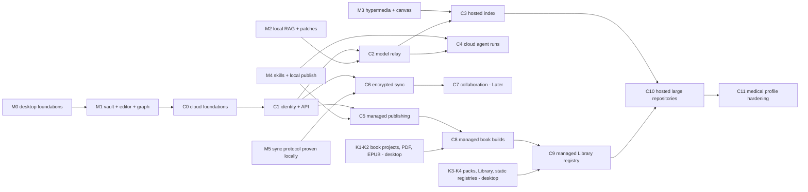

# CHITKALA on AWS — Implementation Plan

Companion to [`CHITKALA_AWS_ARCHITECTURE.md`](CHITKALA_AWS_ARCHITECTURE.md) (the "AWS design") and the core
[`../CHITKALA_TECHNICAL_DESIGN.md`](../CHITKALA_TECHNICAL_DESIGN.md) (the "TDD").

**Sequencing rule (TDD §21.4):** a cloud phase starts only after the desktop milestone it depends on has passed its
data-loss and security gates. The cloud never leads the product; it follows the local-first core.

| Phase | Stage on the overview map | Depends on | Delivers |
|---|---|---|---|
| **C0** Cloud foundations | — | M1 exit gate | Accounts, CI/CD, CDK skeleton, guardrails. No user features |
| **C1** Identity & API | Stage 1 | C0 | Sign-in, device registry, `/v1` skeleton, push channel, observability |
| **C2** Model relay | Stage 2 | C1, M2 local RAG + citation verifier | Consent-gated Bedrock relay with budgets and Guardrails |
| **C3** Hosted index | Stage 3 | C2, M3 | Consented corpus, indexer, Aurora hybrid retrieval, web-companion search |
| **C4** Cloud agent runs | Stage 4 | C2, M4 skills + local patch review | Step Functions runs, broker, sandbox, review round-trip |
| **C5** Managed publishing | Stage 5 | C1, M4 local publish | Isolated build, scan, preview, promote/rollback |
| **C6** Encrypted sync | Stage 6 | C1, M5 conflict matrix passing locally | E2EE sync service, device keys, notifications |
| **C7** Collaboration | (separate diagram) | C6, RFC | Yjs relay — Later |
| **C8** Managed book builds | Stage 7 | C5, Packs K1–K2 | Book pipeline: reviews, validation, render site/PDF/EPUB, pack build, KMS signing |
| **C9** Managed Library registry | Stage 7 | C8, Packs K3–K4 | Catalog, entitlements, institution SSO, CloudFront delivery, update notices, mirrors |
| **C10** Hosted large repositories | (zoom-in) | C9, C3 | Static edition sites at scale, OpenSearch hybrid search, "ask this book" |
| **C11** Medical profile hardening | (zoom-in) | C10, Packs K5–K7 | PHI scanning, clinical review gates, safety errata, clinical AI rules, external review |

Durations below are rough estimates for **two engineers working part-time on the cloud track** alongside the desktop
team. They are planning placeholders, not commitments; re-estimate after C0.

---

## C0 — Cloud foundations (≈ 3 weeks)

**Goal:** a secure, empty, reproducible landing zone and pipeline, so every later phase ships through the same path.

| ID | Work item | Output |
|---|---|---|
| C0.1 | AWS Organizations: management, security, log-archive, tooling, staging, production accounts; SCPs (Region allowlist, protect CloudTrail/GuardDuty, deny IAM user keys) | Account map, SCP JSON in repo |
| C0.2 | Org CloudTrail → log archive (Object Lock); GuardDuty, Config, Security Hub, IAM Access Analyzer delegated to security | Findings visible in one place |
| C0.3 | `infra/` CDK app (TypeScript) in the monorepo; `cdk-nag` checks in CI; tagging (`capability`, `stage`, `tenant-tier`) | `pnpm infra:synth` passes |
| C0.4 | GitHub Actions OIDC → tooling deploy role; per-environment deploy roles; pinned actions; branch protection; environments with required reviewers | No stored AWS keys anywhere |
| C0.5 | `NetworkStack` (isolated subnets ×2 AZ, gateway + interface endpoints) and `SecurityStack` (KMS keys, WAF ACL skeleton) | Deployed to staging |
| C0.6 | AWS Budgets + cost anomaly detection per account; cost-allocation tags activated | Alerts to maintainers |
| C0.7 | ADR AWS-001…011 recorded as Markdown ADRs in `docs/adr/` | Reviewed ADRs |
| C0.8 | Spikes S2 (Lambda language), S8 (endpoint cost), S9 (Region shortlist) | Spike reports |

**Exit gate:** clean `cdk deploy` to staging from a PR merge; Security Hub foundational standard with no critical
findings; a teardown script removes staging completely and a re-deploy works.

---

## C1 — Identity & API (≈ 4 weeks)

**Goal:** the desktop can optionally sign in, register a device and talk to an authenticated, tenant-isolated API.

| ID | Work item | Output |
|---|---|---|
| C1.1 | `IdentityStack`: Cognito user pool, passkeys/MFA, desktop app client (PKCE, loopback redirect), web app client | Spike S1 resolved |
| C1.2 | Desktop: sign-in flow, tokens in OS keychain, "Cloud features" settings page (all off by default) | Desktop PR |
| C1.3 | `ControlDataStack`: DynamoDB single table (§7.2 of the AWS design), TTL, PITR, Streams | Table + access-pattern tests |
| C1.4 | `ApiStack`: HTTP API with JWT authorizer, WebSocket API, Lambda handler skeletons per domain (`identity`, `agents`, `index`, `publish`, `sync`), structured errors, idempotency middleware | OpenAPI `v1` updated |
| C1.5 | Tenant-scoped sessions: STS `AssumeRole` with `tenant` session tag; IAM ABAC on DynamoDB `LeadingKeys` and S3 prefixes | Isolation library + tests |
| C1.6 | Capability-grant evaluator shared with the desktop (`packages/domain` grant model), used by every handler | Same test vectors pass locally and in Lambda |
| C1.7 | Device registry: `POST /v1/devices`, list, revoke; WebSocket connect/disconnect handlers storing connections | Device management UI |
| C1.8 | `ObservabilityStack`: EMF metrics, X-Ray/ADOT tracing, log retention, redaction middleware, dashboards, alarms | Dashboard links in runbook |
| C1.9 | WAF rules (rate-based, managed common rules) on API and CloudFront | WAF metrics |

**Tests:** cross-tenant access attempts on every route (forged ids, swapped JWTs) must fail; token expiry/refresh;
device revoke closes its WebSocket and rejects its JWT; log scan confirms no request bodies are logged.

**Exit gate:** tenant-isolation suite green; desktop works identically signed-out and offline (TDD invariant 9).

---

## C2 — Model relay (≈ 3 weeks)

**Prerequisite:** desktop M2 read-only Q&A with local retrieval and the citation verifier passing its suite.

| ID | Work item | Output |
|---|---|---|
| C2.1 | `RelayStack`: relay Lambda with response streaming, Function URL behind CloudFront (OAC + WAF); spike S4 | Streaming endpoint |
| C2.2 | Consent enforcement: vault provider policy mirrored to DynamoDB; relay refuses `local-only` vaults and out-of-scope chunk ids | Consent tests |
| C2.3 | Budgets: monthly token budget per tenant with atomic conditional counters; `429 budget_exhausted` | Budget tests |
| C2.4 | Bedrock integration: Converse API, model registry (family + fallback order) as configuration; capability discovery for the desktop | Model config in SSM |
| C2.5 | Bedrock Guardrails: prompt-attack and PII filters on document context; spike S7 tuning on technical notes | Guardrail version pinned |
| C2.6 | Citation contract: relay passes only supplied chunk ids; drops unknown ids; desktop verifier unchanged | Contract tests |
| C2.7 | Desktop: "Use cloud model" option with the consent preview (model, data categories, approximate size) | Desktop PR |

**Tests:** TDD §9.7 evaluation run with the relay as provider: citation exactness ≥ 95 %, zero fabricated ids, zero
out-of-scope context; prompt-injection fixtures (instructions embedded in notes) produce no tool calls or policy
changes; network-off fallback message.

**Exit gate:** TDD M2 quality gates pass with the relay; no prompt text appears in any log or trace.

---

## C3 — Hosted index (≈ 5 weeks)

**Prerequisite:** C2; desktop M3 (parser/chunker packages stable).

| ID | Work item | Output |
|---|---|---|
| C3.1 | Spike S3: Aurora Serverless v2 (min 0 ACU) with pgvector HNSW + tsvector; benchmark vs local SQLite on 10k/50k fixtures | Spike report, go/no-go |
| C3.2 | `IndexStack`: corpus bucket (SSE-KMS tenant key), SQS + DLQ, indexer and retriever Lambdas in isolated subnets, RDS Proxy or Data API | Deployed stack |
| C3.3 | Aurora migrations ported from `schema.sql` (tenant + scope columns, RLS policies, HNSW + GIN indexes) | Migration runner |
| C3.4 | Indexer: reuse `packages/markdown` + `packages/retrieval`; heading-aware chunks; idempotent upserts; embedding namespaces | Golden-vault parity test |
| C3.5 | Retriever: lexical, vector and graph channels, RRF, optional rerank, budget; `POST /v1/search` per `SearchHit` contract | Retrieval API |
| C3.6 | Consent lifecycle: desktop folder picker → upload; revoke → delete propagation; nightly reconciler | Revoke tests |
| C3.7 | Web companion (read-only): sign in, search, ask with citations (no vault access, no editing) | Minimal web app on CloudFront |

**Tests:** parity: hosted retrieval recall@10 within 5 % of local on the same fixture; RLS fuzzing across tenants and
scopes; revoke a folder → zero hits from it within 5 minutes; embedding model switch creates a new namespace with no
mixed results.

**Exit gate:** zero cross-scope leakage across the permission fixture suite; rebuild-from-corpus drill succeeds and its
duration is documented.

---

## C4 — Cloud agent runs (≈ 6 weeks)

**Prerequisite:** C2; desktop M4 skill registry, local agent runtime and patch review with CAS commit.

| ID | Work item | Output |
|---|---|---|
| C4.1 | `AgentsStack`: Step Functions Standard state machine implementing TDD §10.3 states, with `waitForTaskToken` for permission and review | ASL in repo |
| C4.2 | Run starter: skill-manifest validation, grant loading, idempotent `StartExecution` | `POST /v1/agent-runs` |
| C4.3 | Context packs: desktop builds and uploads the in-scope pack; deletion on terminal state + lifecycle backstop | Pack tests |
| C4.4 | Policy broker Lambda: schema, grant, quota, timeout, provenance, untrusted-output tagging | Broker library |
| C4.5 | Sandbox: ECS cluster, Fargate task definition (read-only root, non-root, no egress), runner image in ECR; spike S6 vs AgentCore Code Interpreter | Sandbox image |
| C4.6 | MCP adapter with destination allowlist, size limits and sanitisation | Adapter |
| C4.7 | Proposal writer: diff + base revision + evidence + paragraph provenance; WebSocket `agent.approval.required` | Proposal schema |
| C4.8 | Desktop: cloud-run view, event stream with cursor replay, review → local CAS commit → `apply-receipt` | Desktop PR |
| C4.9 | Audit: Object-Locked audit records; run trace export | Audit bucket |
| C4.10 | OpenAPI change: `/patches/{id}/apply` → `/patches/{id}/apply-receipt` (server never applies) | Contract PR |

**Tests:** adversarial agent suite (TDD §18.4 "Agent safety"): zero unauthorised writes; sandbox egress tests (DNS,
HTTP, instance metadata) all blocked; duplicate start with same idempotency key → one execution; review timeout →
`EXPIRED`; concurrent local edit → CAS conflict → regenerate path.

**Exit gate:** TDD M2/M4 agent-safety gate passes against cloud runs; a run cannot change any vault without a desktop
commit.

---

## C5 — Managed publishing (≈ 4 weeks)

**Prerequisite:** C1; desktop M4 local Astro publish with the privacy suite passing.

| ID | Work item | Output |
|---|---|---|
| C5.1 | `PublishStack`: publish bucket, CodeBuild project in VPC (no NAT), builder image pinned in ECR | Stack |
| C5.2 | Bundle protocol: desktop computes public closure, strips EXIF/private transclusions, uploads by presigned URL | Bundle spec |
| C5.3 | Cloud re-validation in the build: links, public-only graph and search index, CSP, secret patterns | Build checks |
| C5.4 | Macie job on new build prefixes; promotion blocked on high-severity findings | Macie integration |
| C5.5 | CloudFront distribution, OAC, response-headers policy (per-site CSP), KeyValueStore + Function for active build; signed preview cookies | Preview + promote |
| C5.6 | Custom domains: Route 53 + ACM automation; deployment receipts; rollback command | `publish.deploy`, `publish.rollback` |

**Tests:** TDD Scenario F (private transclusion) fails the build in the cloud too; rollback restores the previous build
in under a minute; no private title appears in HTML, search index, graph JSON or sitemap (byte search over output).

**Exit gate:** publish-privacy suite: zero leaks across the manifest + transclusion fixture set in both local and cloud
paths.

---

## C6 — Encrypted sync (≈ 6 weeks)

**Prerequisite:** C1; the sync reconciliation engine and conflict matrix (TDD §18.4 "Sync safety") passing with a
local or BYO-S3 transport; spike S5 reviewed.

| ID | Work item | Output |
|---|---|---|
| C6.1 | Crypto: vault key, device key pairs, key wrapping, recovery key, manifest format; external review before release | Crypto design doc + review |
| C6.2 | `SyncStack`: sync bucket (versioning, lifecycle), push/commit/pull routes, DynamoDB head CAS | Sync service |
| C6.3 | Notifier: DynamoDB Streams → WebSocket push (ids only) | Push |
| C6.4 | Desktop: sync adapter for the managed service sharing the reconciliation engine with BYO S3 / Git / WebDAV | Desktop PR |
| C6.5 | Device onboarding: approve a new device from an existing one; revoke + key rotation for new objects | Device UX |
| C6.6 | Backup: PITR, AWS Backup plan, restore drill | Runbook |

**Tests:** full offline conflict matrix (edit/rename/delete × 2–3 devices) against the managed service; server-side
inspection confirms no plaintext object or path; head CAS race tests (parallel pushes) never lose a commit; revoked
device cannot fetch new objects.

**Exit gate:** no silent data loss in the matrix; independent review of the E2EE design complete; product copy reviewed
for accurate encryption claims.

---

## C7 — Collaboration (Later)

Requires its own RFC (security, operations, cost). Outline: Yjs relay on ECS Fargate behind an ALB, ElastiCache pub/sub,
encrypted update log in DynamoDB, encrypted snapshots in S3, client-written Markdown checkpoints through C6 sync. See
§12 of the AWS design.

---

## C8 — Managed book builds (≈ 5 weeks)

**Prerequisite:** C5; the Packs spec's K1 (book projects) and K2 (PDF/EPUB) working locally on the golden book fixture.

| ID | Work item | Output |
|---|---|---|
| C8.1 | `BooksStack`: Books API, editions and sign-off records in DynamoDB, book bundle bucket | Stack |
| C8.2 | Review rules engine shared with the desktop (`book.yaml` `review.rules`), sign-offs bound to proposal hashes; web review view for editors | Rules library + review UI |
| C8.3 | Book pipeline state machine: CheckReviews → Validate → (ScanPHI) → Render (parallel) → BuildPack → Sign → ScanOutputs → AwaitRelease → Release | ASL in repo |
| C8.4 | Render projects in CodeBuild: Astro book theme, PDF engine (spike S10), EPUB builder; pinned builder images | Images in ECR |
| C8.5 | Pack builder on Fargate: chunks, FTS5/graph SQLite, partitions, `files.json`, Bedrock batch embeddings | Pack builder image |
| C8.6 | Publisher KMS keys (ECC_NIST_P256), key policies per publisher, signature format matching local signing | Signing ADR |
| C8.7 | Macie and accessibility gates; audited waivers | Gate reports |

**Tests:** golden book fixture produces byte-identical `content/` and identical numbering locally and in the cloud;
self-approval and missing-reviewer fixtures block; a planted private-note reference fails `Validate`; a tampered
output fails signature verification in the desktop verifier.

**Exit gate:** Packs scenario H passes in the managed pipeline; every release has a complete audit trail.

---

## C9 — Managed Library registry (≈ 5 weeks)

**Prerequisite:** C8; Packs K3 (install from file, read-only mounts, overlays) and K4 (static registries) passing
locally.

| ID | Work item | Output |
|---|---|---|
| C9.1 | `LibraryStack`: pack store (versioned S3), catalog table, signed `catalog.json` generator | Static protocol served from CloudFront |
| C9.2 | Library API: catalog search, edition details, install grants (signed cookies, spike S11), update checks | Routes in OpenAPI |
| C9.3 | Entitlements: open / registered / paid (records only) / institutional; offline leases | Entitlement tests |
| C9.4 | Cognito federation for institutions (SAML/OIDC), group → licence mapping, seat counts | Institution onboarding runbook |
| C9.5 | Update notices: EventBridge → notifier → WebSocket (opt-in installs); severity handling | Notifier |
| C9.6 | Publisher onboarding: key registration, verification badge process, revocation list publishing | Publisher console (minimal) |
| C9.7 | Mirrors: S3 replication template and a "static export" of the registry for intranet/USB | Mirror guide |
| C9.8 | Desktop: Library space wired to managed and static registries, "Open in CHITKALA" deep links | Desktop PR |

**Tests:** Packs scenarios I, J, M, N against the managed registry; entitlement fuzzing (expired lease, revoked
institution membership, cookie reuse across editions); revoked publisher key blocks new installs; a mirror copied to a
local folder installs offline.

**Exit gate:** no install succeeds without a valid signature chain; registry works with the managed service switched
off (static protocol only).

---

## C10 — Hosted large repositories (≈ 5 weeks)

**Prerequisite:** C9; C3 retrieval code shared.

| ID | Work item | Output |
|---|---|---|
| C10.1 | Spike S12: OpenSearch Serverless vs Aurora pgvector vs S3 Vectors at 1M documents | Decision record |
| C10.2 | `RepositoryStack`: edition-site hosting, sharded static search, OpenSearch collection, indexer | Stack |
| C10.3 | "Ask this book": edition-scoped hybrid retrieval, Guardrails grounding check, abstention, citations, answer cache, quotas | `POST …/ask` |
| C10.4 | Partial installs from the hosted site ("install this section") | Deep link with partitions |
| C10.5 | Load tests: 1M documents, 10 queries/s sustained, CloudFront cache-hit targets | Load-test report |

**Tests:** retrieval benchmark on a public-domain large corpus fixture; abstention fixtures (questions with no support
must abstain); cross-edition leakage tests; quota and WAF behaviour under abuse.

**Exit gate:** scale targets in the Packs spec §10.1 met or re-baselined with evidence; zero uncited answers in the
evaluation set.

---

## C11 — Medical profile hardening (≈ 4 weeks + external review)

**Prerequisite:** C10; Packs K5 (editorial workflow) and K7 (medical profile) implemented locally.

| ID | Work item | Output |
|---|---|---|
| C11.1 | Comprehend Medical PHI scanning in the pipeline; spike S13 on false negatives; waiver workflow | PHI gate |
| C11.2 | Structured clinical block schemas (dose tables, monographs) validated in `Validate`; UCUM checks | Schemas |
| C11.3 | Two-clinical-reviewer gates and numeric-diff highlighting in web review | Review UI |
| C11.4 | Safety-critical errata: push + banners + hosted-site notices; drill | Errata runbook |
| C11.5 | Clinical AI rules for "ask this book": abstention policy, disclaimer, no patient-specific dosing | Guardrail config + tests |
| C11.6 | External clinical-editor review and legal review of claims and regulatory position per launch country | Review reports |

**Exit gate:** Packs scenario L drill passes; medical fixture suite green; external reviews complete before any
medical publisher goes live.

---

## Cross-cutting definition of done (every phase)

- [ ] CDK stack reviewed, `cdk-nag` clean or suppressions justified in code.
- [ ] Spec + ADR updated; OpenAPI updated for any route change.
- [ ] Unit, integration and adversarial tests in CI against staging; results attached to the PR.
- [ ] Tenant-isolation and privacy tests extended for the new capability.
- [ ] Dashboards, alarms and runbook entries exist.
- [ ] Cost tags applied; Budgets alert configured; measured cost per 1,000 operations recorded.
- [ ] Feature works when signed out, offline or with the cloud disabled (local path unaffected).
- [ ] Architecture diagram updated in `diagrams/arch_specs.py` and rebuilt with `diagrams/build.sh`.
- [ ] `CHANGELOG.md` says what is implemented and what remains proposed.

## Risk register

| Risk | Likelihood | Impact | Mitigation |
|---|---|---|---|
| Fixed costs (VPC endpoints, KMS keys) dominate at low usage | High | Medium | Share endpoints; tenant-tier keys; spike S8; keep non-VPC Lambdas outside VPCs |
| Aurora resume latency hurts first query | Medium | Medium | Measure in S3; keep min capacity > 0 in paid tier; local-first path unaffected |
| Bedrock model availability differs by Region | Medium | Medium | Region shortlist (S9); model registry with fallbacks |
| Guardrails over-blocks technical content | Medium | Low | Tune (S7); allow per-vault opt-out with warning |
| E2EE design flaw | Low | High | External review before release; no claims until reviewed |
| Agent sandbox escape / exfiltration | Low | High | No-egress subnets, task isolation, adversarial suite, bug bounty later |
| Scope creep into cloud-first features | Medium | High | Sequencing rule; every phase has a local substitute check |
| Maintainer AWS bill from abuse | Medium | Medium | WAF, per-tenant budgets, throttling, Budgets alerts, invite-only beta |
| OpenSearch Serverless minimum cost for small repositories | High | Medium | Shared collections, static search for small books, spike S12 |
| Publisher key compromise | Low | High | KMS keys, per-publisher policies, revocation lists, transparency log (Packs K5) |
| Medical content error reaches readers | Medium | High | Review gates, safety-critical errata push, currency dates, AI abstention, external review |
| Licensing misunderstanding ("DRM") | Medium | Medium | Clear entitlement copy; no protection claims; publisher agreement |

## First sprint for the cloud track (after M1 passes)

1. Create the Organization and accounts (C0.1–C0.2).
2. Scaffold `infra/` with `NetworkStack` and `SecurityStack`; wire GitHub OIDC; deploy to staging (C0.3–C0.5).
3. Write ADRs AWS-001…011 (C0.7).
4. Run spikes S1 (Cognito desktop sign-in) and S2 (Lambda language).
5. Demo: a signed-in desktop calls `GET /v1/me` on staging; the same build used signed-out is unchanged.
