# CHITKALA — Prior Art and the Rust + TypeScript Stack

> **Decision:** CHITKALA's **backend is Rust**: desktop core, indexing, retrieval, agents, sync, packs, the
> self-hosted server and the AWS Lambda handlers. Its **frontend is TypeScript**: the React app shell, CodeMirror
> editor, canvas, graph and web companion. JavaScript-only build tools (MDX compilation, Astro) run as isolated
> workers behind Rust-owned contracts.
>
> **Why now:** several mature open-source tools solve parts of CHITKALA's problem (Foam, SilverBullet, Logseq,
> OpenKnowledge, Zettlr, Trilium, Joplin, SiYuan, AppFlowy). This document records what to adopt,
> adapt and avoid from each, and turns that into the stack, the repository layout and the contracts between Rust and
> TypeScript. It amends [`CHITKALA_TECHNICAL_DESIGN.md`](CHITKALA_TECHNICAL_DESIGN.md) (the "TDD").

**Facts about other projects were checked against their public repositories and documentation on 2026-10-21** (sources
in §7). Projects change; re-check before relying on a detail.

---

## Contents

1. [The projects at a glance](#1-the-projects-at-a-glance)
2. [Lessons: adopt, adapt, avoid](#2-lessons-adopt-adapt-avoid)
3. [The Rust + TypeScript split](#3-the-rust--typescript-split)
4. [Repository layout](#4-repository-layout)
5. [Contracts between Rust and TypeScript](#5-contracts-between-rust-and-typescript)
6. [Decisions, spikes and changes to other documents](#6-decisions-spikes-and-changes-to-other-documents)
7. [Sources](#7-sources)

---

## 1. The projects at a glance

| Project | Licence | Stack | Canonical storage | Best at | Code reuse into Apache-2.0 CHITKALA |
|---|---|---|---|---|---|
| **Foam** | MIT | TypeScript, VS Code extension | Plain Markdown in a git workspace | Obsidian-style linking inside VS Code: wikilinks, backlinks, graph, templates, daily notes | Allowed with attribution |
| **SilverBullet** | MIT | TypeScript + Preact + CodeMirror 6 client; **Rust** server | Markdown pages ("space") | Self-hosted, queryable, scriptable web notebook | Allowed with attribution |
| **Logseq** | AGPL-3.0 | Clojure/ClojureScript | Markdown / Org-mode files; new DB version on SQLite (beta) | Outliner, block references, journals, graphs | Ideas only |
| **OpenKnowledge** (Inkeep) | GPL-3.0 | TypeScript (small Rust component) | Plain Markdown in git | LLM-native wiki: built-in MCP for agents, CLI, agentic search | Ideas only |
| **Zettlr** | GPL-3.0 | Electron, TypeScript, Vue 3, CodeMirror 6 | Plain Markdown files | Academic writing: citations (Zotero/CSL), Pandoc exports | Ideas only |
| **Trilium Notes** (TriliumNext) | AGPL-3.0 | Electron/Node.js, CKEditor 5, CodeMirror | Single database | Deep hierarchies, note cloning, attributes, scripting, relation maps, self-hosted sync, per-note encryption | Ideas only |
| **Joplin** | AGPL-3.0-or-later (some sub-packages differ) | TypeScript, Electron, React Native | Markdown notes kept in a local app database | Offline-first, multi-device **E2EE sync** over Nextcloud, Dropbox, OneDrive, Joplin Cloud | Ideas only |
| **SiYuan** | AGPL-3.0 | Go kernel, TypeScript frontend | JSON `.sy` files (block tree) + SQLite index | Block-level references, SQL queries over blocks, snapshot sync | Ideas only |
| **AppFlowy** | AGPL-3.0 | Flutter + Rust; collaboration on **yrs** | CRDT collab objects | Notion-like docs and databases, real-time collaboration | Ideas only |

**Licence rule for CHITKALA (Apache-2.0, TDD ADR-009):** no code is copied from AGPL or GPL projects (Logseq,
OpenKnowledge, Zettlr, Trilium, Joplin, SiYuan, AppFlowy). We learn from their designs and documentation only. MIT
projects (Foam, SilverBullet) may be reused with attribution, but the default is still to re-implement ideas in our own
Rust/TypeScript architecture. Running Pandoc as a **separate, optional, user-installed executable** is allowed;
bundling GPL binaries into releases needs a licence review.

### 1.1 Which is closest to Obsidian?

| Dimension | Closest | Why |
|---|---|---|
| **Data model** (plain Markdown, `[[wikilinks]]`, folders, frontmatter) | **Foam**, then SilverBullet, OpenKnowledge, Zettlr | Same files Obsidian reads; no database as source of truth |
| **Linking features** (backlinks, graph, dangling links, daily notes, templates) | **Foam** | Almost one-to-one with Obsidian's core plugins |
| **Standalone app experience** (own editor, panes, plugins) | Logseq, SiYuan, Joplin, Trilium | Foam lives inside VS Code; it borrows VS Code's editor, tabs and extension model |
| **Licence fit** with Apache-2.0 | **Foam**, SilverBullet (MIT) | The rest are copyleft |

**Conclusion:** Foam is the closest to Obsidian in what matters most for CHITKALA's canonical format, and its MIT
licence makes it the best reference implementation for link semantics. CHITKALA's position is **Foam's file model in a
dedicated local-first app**, plus source-grounded AI, agents, books and Knowledge Packs, and a Rust language server so
the same vault also works in VS Code (§2.1).

---

## 2. Lessons: adopt, adapt, avoid

### 2.1 From Foam (closest to Obsidian)

| | Lesson | In CHITKALA |
|---|---|---|
| **Adopt** | Wikilinks with aliases and section links, backlinks with context, graph, orphans, **placeholders** (links to notes that don't exist yet) | Placeholders are first-class graph nodes (`link_status = broken` → "create note" action); orphans view in the Library |
| **Adopt** | **Link reference definitions** generated for wikilinks so notes render correctly on GitHub and in other Markdown tools | Optional per vault and **always on for publishing and packs**: exports add reference definitions so links work outside CHITKALA (TDD P07) |
| **Adopt** | Templates and daily notes as simple, file-based conventions | Template folder + daily-note command; no hidden state |
| **Adopt** | Git as an ordinary storage and sharing layer | Git adapter for sync/export (TDD §14.4) stays first-class |
| **Adapt** | The editor and workspace are VS Code's | CHITKALA ships its own app **and** a Rust language server (`chitkala-lsp`): wikilink completion, go-to-definition, backlinks, rename, diagnostics for broken links, in VS Code, Zed, Neovim. Same `chitkala-markdown` + `chitkala-index` crates |
| **Avoid** | Alpha-grade stability as a long-term state | Data-loss and integrity gates before features (TDD §21.4) |

### 2.2 From SilverBullet

| | Lesson | In CHITKALA |
|---|---|---|
| **Adopt** | Same split we chose: **Rust server, TypeScript + CodeMirror client** | Strong signal the boundary works for a Markdown knowledge tool |
| **Adopt** | **Objects and queries over Markdown**: tasks, tagged items and frontmatter become queryable objects | `chitkala-index` extracts typed objects into SQLite; a ```` ```query ```` block renders live results; queries run in Rust |
| **Adopt** | Offline web client: service worker cache + sync | The web companion is a PWA with a service worker; sync uses the same Rust protocol (WASM or via the server) |
| **Adapt** | Space Lua scripting for commands, templates and widgets | Scripting runs **sandboxed in the Rust core** (WASM via wasmtime first; mlua candidate), with grants (TDD §10.7) |
| **Adapt** | "Client runs most logic, server is a file store" | Fine for the personal server; CHITKALA's server also enforces grants, budgets and consent because it runs agents and relays models |
| **Avoid** | Scripts in shared or imported notes executing automatically | Imported or pack content never runs scripts (TDD zone 3) |

### 2.3 From Logseq

| | Lesson | In CHITKALA |
|---|---|---|
| **Adopt** | Block references and embeds as everyday tools; journals | Obsidian-compatible block ids (`^block-id`) resolved by the Rust parser; block embeds in preview; daily notes |
| **Adopt** | Org-mode users exist | Read-only Org import adapter later (TDD §6.5 format table) |
| **Adapt** | Outliner editing | An optional outline mode over ordinary Markdown lists, not a separate block database |
| **Avoid** | Moving the source of truth from files to a database (Logseq's DB version is in beta with data-loss warnings) | Markdown stays canonical (ADR-002); SQLite is always a rebuildable projection |

### 2.4 From OpenKnowledge

| | Lesson | In CHITKALA |
|---|---|---|
| **Adopt** | **Built-in MCP server** so external agents (Claude, Cursor, Codex) can use the knowledge base | `chitkala mcp` exposes the vault as an MCP server: read/search/graph tools by default; writes only as **patch proposals** the author reviews; every tool call checked by `chitkala-policy` |
| **Adopt** | CLI and local web UI next to the app; git-backed sharing | `chitkala` CLI + self-host server; Git adapter |
| **Adapt** | "LLM wiki": agents write pages | Agents may draft, but only through patches with provenance labels (TDD §9.8, §10.8) |
| **Avoid** | Treating agent-written pages as knowledge without review | Human approval stays mandatory for writes |

### 2.5 From Zettlr

| | Lesson | In CHITKALA |
|---|---|---|
| **Adopt** | CodeMirror 6 as the Markdown editor | Already the TDD choice |
| **Adopt** | Citations from a live CSL JSON / BibTeX export (Zotero Better BibTeX "keep updated") | Book projects watch the exported file and re-resolve citations; CSL in Rust (spike S-R5) |
| **Adopt** | Export **profiles** (Pandoc defaults files) and user templates | `book.yaml` output profiles; optional "Pandoc profile" with the user's own Pandoc |
| **Adopt** | Watch the folder and reconcile external edits | `chitkala-files` watcher (debounced, hash-checked, TDD §12.3) |
| **Adapt** | Bundled Pandoc + LaTeX for PDF | Native **Typst** (Rust) for book PDFs; Pandoc optional and external |
| **Avoid** | Electron's footprint | Tauri 2 + Rust core (ADR-001) |

### 2.6 From Trilium Notes

| | Lesson | In CHITKALA |
|---|---|---|
| **Adopt** | **Cloning**: one note in several places of the tree | Collections and saved views reference `document_id`s; a note can appear in many collections without copies |
| **Adopt** | Attributes and **relation maps** | Typed semantic edges with provenance (TDD §8) and a relation-map canvas view |
| **Adopt** | Per-note encryption | "Sealed notes": per-document encryption in the vault with a key in the OS keychain; never indexed or sent to models unless unsealed |
| **Avoid** | A database as the canonical store; deep nesting as the only organisation | Files canonical; links, tags and collections alongside folders |

### 2.7 From Joplin

| | Lesson | In CHITKALA |
|---|---|---|
| **Adopt** | **E2EE sync over many storage back ends** (Nextcloud/WebDAV, Dropbox, OneDrive, own server) | Confirms the adapter design: one reconciliation engine, many transports (TDD §14.4); managed AWS sync is just one of them |
| **Adopt** | Offline-first on desktop and mobile | Mobile reading app later uses the same Rust core (Packs spec K8) |
| **Adopt** | A self-hostable server in the same repository | `chitkala-server` (ADR-018) |
| **Avoid** | Notes living inside an app database | Files canonical |

### 2.8 From SiYuan

| | Lesson | In CHITKALA |
|---|---|---|
| **Adopt** | **SQL-style queries over blocks** embedded in documents, and the same queries from a CLI | `query` blocks and `chitkala query` run against the Rust index (read-only, scoped by grants) |
| **Adopt** | Snapshot-based sync repository with a data key | Informs the manifest + content-addressed object design (AWS design §8) |
| **Adopt** | "Humans and AI agents work together" with local-first data | Same direction; CHITKALA adds verifiable citations and patch-only writes |
| **Avoid** | JSON block files as canonical (not readable as Markdown elsewhere) | Markdown canonical |

### 2.9 From AppFlowy

| | Lesson | In CHITKALA |
|---|---|---|
| **Adopt** | A Rust core owns data, storage and sync; the UI is a client of it | The Tauri Rust core is the only writer of the vault; same crates power the server and Lambda (§3.3) |
| **Adopt** | **yrs** for real-time collaboration with persistence behind a plugin trait | `chitkala-collab` uses yrs; the editor uses Yjs (same update format) |
| **Adapt** | Documents stored as CRDT objects | Markdown canonical; CRDT only during live sessions, checkpointed to Markdown (TDD §14.5) |
| **Avoid** | Self-hosting drifting into a separate commercial repository (the open AppFlowy-Cloud repo is archived) | The self-host server stays in the main Apache-2.0 repository |

### 2.10 What none of them do (CHITKALA's differentiators)

Source-grounded AI with machine-verifiable citations, patch-only agent writes (including writes from external agents
over MCP), consent-scoped model context, signed installable Knowledge Packs and textbooks with editions and errata, and
an explicit public-content allowlist.

---

## 3. The Rust + TypeScript split

### 3.1 Boundary rule

> **Rust owns anything that touches user data, security, indexes, the network, cryptography or long-running work.
> TypeScript owns what the user sees and types into.**

| Concern | Rust | TypeScript |
|---|---|---|
| Vault files, atomic writes, watcher, journal | ✅ | — |
| Policy broker, grants, consent, budgets | ✅ | displays and requests grants |
| Markdown semantics: links, headings, blocks, objects, chunks, citations | ✅ (single parser) | — |
| Editor UX: syntax highlighting, folding, autocomplete, keybindings | — | ✅ CodeMirror 6 + Lezer grammar |
| Preview HTML for Markdown (sanitised) | ✅ renders + sanitises | displays; hydrates trusted components |
| MDX compilation (produces JavaScript) | orchestrates + sandboxes | ✅ in an isolated worker (TDD §7.4) |
| Search (FTS, vectors, graph, RRF) | ✅ | query UI |
| Agents: state machine, tools, MCP | ✅ | Agent Studio UI |
| Sync, E2EE, CRDT server side | ✅ | Yjs in the editor for live sessions |
| Book builds: numbering, cross-refs, citations, Typst PDF, EPUB, pack build and signing | ✅ | — |
| Static site build | orchestrates | ✅ Astro in an isolated build worker |
| Canvas, graph view, dashboards | — | ✅ React Flow, Excalidraw, Cytoscape/Sigma |
| Web companion (PWA) | ✅ via WASM or server API | ✅ UI + service worker |

**One parser.** Semantic parsing lives only in Rust, so links, chunks and citations mean the same thing in the desktop,
the server, Lambda, the pack builder and the CLI. The editor's Lezer grammar is for highlighting only; a shared
conformance fixture set checks that both agree on what is a link, heading or block (TDD §18 golden vaults).

### 3.2 Recommended Rust building blocks

Versions are chosen in the first ADR and pinned by `Cargo.lock`; every crate goes through `cargo-deny` (licences +
advisories).

| Need | Candidate crates | Notes |
|---|---|---|
| Desktop host | `tauri` 2, `tauri-specta` | Typed commands → generated TS bindings |
| Async, HTTP server | `tokio`, `axum`, `tower` | Self-host server and local optional HTTP API |
| Lambda | `lambda_runtime`, `lambda_http` (AWS Rust runtime, GA since Nov 2025), `cargo-lambda` | ARM64 (Graviton) builds |
| AWS APIs | `aws-sdk-*` (AWS SDK for Rust) | Bedrock, DynamoDB, S3, KMS, Step Functions |
| Markdown AST with positions | `markdown` (markdown-rs, mdast + MDX syntax) or `comrak` | Spike S-R1: Obsidian syntax extensions, source maps, speed |
| HTML sanitising | `ammonia` | Tier-0 safe preview (TDD §7.4) |
| SQLite + FTS5 | `rusqlite` (bundled SQLite with FTS5) | Matches `schema.sql` |
| Large-pack lexical search | `tantivy` (optional) | Spike S-R2 vs FTS5 at 50k+ documents |
| Vectors | `sqlite-vec` via rusqlite, or `lancedb` | Behind a trait (TDD §5.3 caveat) |
| Local embeddings | `ort` (ONNX Runtime) or `candle` | Optional; Ollama-compatible HTTP adapter remains the default |
| Diff / patches | `similar` | Patch proposals and review diffs |
| File watching | `notify` | Debounced, hash-checked |
| CRDT | `yrs` | Collaboration (Later) |
| Crypto | RustCrypto (`chacha20poly1305`, `ed25519-dalek`, `p256`, `sha2`), OS keychain via `keyring` | Use vetted crates only; external review before E2EE claims |
| MCP | `rmcp` (official Rust MCP SDK) | Behind the policy broker |
| Scripting sandbox | `wasmtime` (WASI); `mlua` candidate | Fuel/time limits, no ambient authority |
| Typesetting | Typst crates | Book PDFs (Packs spec K2 → Typst preferred) |
| Schemas and OpenAPI | `serde`, `schemars`, `utoipa` | JSON Schema for manifests; OpenAPI from handlers |
| Errors, tracing | `thiserror`, `tracing`, `tracing-opentelemetry` | Correlation ids, redaction layer |
| Tests | `cargo-nextest`, `proptest`, `insta` (snapshots), `criterion` (benchmarks) | Property tests for paths, links, sync merges |

### 3.3 One service layer, three hosts

```text
                ┌──────────────── chitkala-services (Rust traits + implementations) ───────────────┐
                │ vault · documents · index · search · graph · agents · patches · sync · packs …  │
                │ every call → chitkala-policy (grants, consent, budgets) → audit                  │
                └───────────────┬───────────────────────────┬───────────────────────────┬────────────┘
                     Tauri commands                Axum HTTP server              Lambda handlers
                  (+ CLI, language server and MCP server use the same services)
                 (desktop, local-first)        (self-host single binary,     (managed AWS, per-domain
                                                Docker image, Pi/NAS)          functions, ARM64)
```

The same capability checks run in every host (TDD §13.1.6). The self-host server is the **AppFlowy lesson applied**:
it is in the main repository, Apache-2.0, built from the same crates as the managed service.

### 3.4 TypeScript side

| Package | Contents |
|---|---|
| `apps/desktop` | Tauri front end: React shell, panes, themes |
| `apps/web` | Web companion PWA: same UI packages, service worker, IndexedDB/OPFS cache |
| `packages/ui` | Design tokens, Radix/shadcn wrappers, panes |
| `packages/editor` | CodeMirror 6 extensions, Lezer Markdown grammar with Obsidian syntax, Yjs binding |
| `packages/canvas`, `packages/graph-view` | React Flow, Excalidraw adapter, graph rendering |
| `packages/bindings` | **Generated** TS types and clients from Rust (never hand-edited) |
| `workers/mdx` | MDX compile worker (isolated process/iframe, no privileged bridge) |
| `workers/astro-site` | Astro site/book theme build worker |

---

## 4. Repository layout

Replaces TDD §6.1.

```text
chitkala/
├── Cargo.toml                    # Rust workspace
├── pnpm-workspace.yaml           # TypeScript workspace
├── crates/
│   ├── chitkala-domain/          # ids, entities, errors, schemaVersion types (serde + specta + schemars)
│   ├── chitkala-files/           # atomic writes, journal, watcher, path policy, backups
│   ├── chitkala-markdown/        # the one parser: AST, Obsidian syntax, objects, source maps, sanitised HTML
│   ├── chitkala-index/           # SQLite FTS5, metadata, objects, edges, migrations, queries
│   ├── chitkala-retrieval/       # chunking, embeddings adapters, vectors, RRF, citations + verifier
│   ├── chitkala-policy/          # grants, consent, budgets, audit
│   ├── chitkala-patch/           # proposals, diffs, CAS commit
│   ├── chitkala-agents/          # run state machine, tool registry, MCP (rmcp), sandbox (wasmtime)
│   ├── chitkala-models/          # provider adapters: Ollama-compatible, Bedrock, OpenAI-compatible
│   ├── chitkala-sync/            # sync protocol, reconciliation, E2EE
│   ├── chitkala-collab/          # yrs sessions, checkpoint to Markdown (Later)
│   ├── chitkala-books/           # book.yaml, numbering, cross-refs, CSL citations, Typst PDF, EPUB
│   ├── chitkala-packs/           # .ckpack build, sign, verify, install, deltas, registries
│   ├── chitkala-services/        # service traits wiring the crates above (§3.3)
│   ├── chitkala-tauri/           # Tauri commands (desktop host)
│   ├── chitkala-server/          # Axum server (self-host host) + Dockerfile
│   ├── chitkala-lambda/          # Lambda handlers per domain (AWS host)
│   ├── chitkala-lsp/             # language server: wikilinks, backlinks, rename, diagnostics (VS Code, Zed, Neovim)
│   ├── chitkala-mcp/             # MCP server exposing the vault to external agents under grants (rmcp)
│   └── chitkala-cli/             # `chitkala` CLI: rebuild-index, query, build-book, verify-pack, serve, mcp, lsp
├── apps/      desktop/  web/  docs/
├── packages/  ui/  editor/  canvas/  graph-view/  bindings/
├── workers/   mdx/  astro-site/
├── infra/                        # AWS CDK (TypeScript) — see AWS/CHITKALA_AWS_ARCHITECTURE.md §18
├── schemas/                      # generated JSON Schemas + OpenAPI (checked in, CI checks drift)
├── fixtures/                     # golden vaults, golden book, packs, conformance cases
└── tests/                        # E2E (Playwright), cross-language conformance, benchmarks
```

The **CLI** gives publishers and CI a headless path (`chitkala build-book`, `chitkala verify-pack`), and is how the
AWS pack builder and book pipeline run the exact same code as a desktop build.

---

## 5. Contracts between Rust and TypeScript

1. **Rust types are the source of truth.** `chitkala-domain` types derive `serde`, `specta` and `schemars`.
2. **Generated, checked-in bindings.** `tauri-specta` generates the IPC client; `utoipa` generates OpenAPI for the
   server and Lambda routes, from which the TS HTTP client is generated; `schemars` generates JSON Schemas for
   `book.yaml`, `pack.yaml`, skill manifests and events. CI regenerates and fails on any diff.
3. **`api.openapi.yaml` becomes generated** once handlers exist; until then the hand-written draft is the target the
   Rust handlers must match (contract tests).
4. **Errors** use one Rust enum mapped to the structured error model (`code`, `message`, `details`, `requestId`,
   `retryable`, TDD §13.1).
5. **Streams** (agent events, sync notices) are typed events with sequence numbers, delivered as Tauri events locally
   and WebSocket/SSE remotely, with the same payload types.
6. **No privileged JS.** The TypeScript app receives only the commands its capability set allows (Tauri permissions);
   untrusted content and MDX workers receive none.

---

## 6. Decisions, spikes and changes to other documents

### 6.1 New ADRs (added to TDD §22)

| ADR | Decision | Status |
|---|---|---|
| ADR-016 | Rust backend everywhere (core, server, Lambda, CLI); TypeScript frontend | **Accepted direction** |
| ADR-017 | Rust domain types are the source of truth; TS bindings, OpenAPI and JSON Schemas are generated | Proposed |
| ADR-018 | One service layer, three hosts (Tauri, Axum self-host, Lambda); self-host stays in the main Apache-2.0 repo | Proposed |
| ADR-019 | Markdown semantics parsed only in Rust; the editor grammar is for UX only, checked by conformance fixtures | Proposed |
| ADR-020 | User scripting and queries run sandboxed in Rust (WASM first), only in the user's own vault, under grants | Proposed |
| ADR-021 | Learn from AGPL/GPL projects by design only; no code reuse; Pandoc only as an optional external tool | **Recommended invariant** |
| ADR-022 | Ship a Rust language server (`chitkala-lsp`) so vaults work in other editors (Foam lesson) | Proposed |
| ADR-023 | Expose the vault to external agents as an MCP server; reads by grant, writes only as patch proposals (OpenKnowledge lesson) | Proposed |
| ADR-024 | Exports, publishing and packs add Markdown link reference definitions for wikilinks (Foam lesson) | Proposed |

### 6.2 Spikes

| ID | Question | Exit criterion |
|---|---|---|
| S-R1 | `markdown` (markdown-rs) vs `comrak` for Obsidian syntax, MDX awareness, source positions, speed | 10k-note golden vault parsed with exact byte spans; p95 parse per note < 2 ms |
| S-R2 | SQLite FTS5 vs tantivy for 50k-document packs | Latency and index size vs the Packs spec §10.1 targets |
| S-R3 | Web companion: Rust compiled to WASM in the browser (OPFS SQLite) vs thin client over the server | Offline capability, bundle size, code sharing |
| S-R4 | Scripting sandbox: wasmtime components vs mlua with restricted globals | Escape tests, fuel/time limits, author ergonomics |
| S-R5 | CSL citation processing in Rust (crate maturity) vs a sandboxed citeproc-js worker | Output parity on 600-reference fixture across Vancouver/APA |
| S-R6 | Typst embedding for 1,500-page books; PDF/UA tagging status | Build time, memory, accessibility |
| S-R7 | Rust Lambda cold start and binary size per domain function on ARM64 | p95 cold start; deployment size |

### 6.3 What changed elsewhere

| Document | Change |
|---|---|
| `CHITKALA_TECHNICAL_DESIGN.md` | §5.3 stack rows, §6.1 points here, §19.1 onboarding, ADR-016…024, "Main languages" |
| `CODE_ASSIST_HANDOFF.md` | Scaffold = Cargo + pnpm workspaces, generated bindings, Rust parser |
| `CHITKALA_KNOWLEDGE_PACKS_AND_TEXTBOOKS.md` | Book and pack builders are Rust crates + CLI; Typst preferred for PDF; Zettlr-style citation sources and export profiles |
| `AWS/CHITKALA_AWS_ARCHITECTURE.md` | Lambdas in Rust (S2 resolved), self-host Axum server, Rust indexer/pack builder, yrs collaboration relay, ADR AWS-018 |
| `AWS/CHITKALA_AWS_IMPLEMENTATION_PLAN.md` | C0–C8 items name the Rust crates and toolchain |
| `AWS/diagrams/arch_specs.py` | Rust labels on compute; new `chitkala-code-architecture` diagram |



---

## 7. Sources

Checked 2026-10-21.

- Foam (VS Code extension, MIT, wikilinks/backlinks/graph/placeholders, link reference definitions): <https://github.com/foambubble/foam>
- Logseq (Clojure/ClojureScript, AGPL-3.0, Markdown/Org files, DB version beta with RTC): <https://github.com/logseq/logseq>
- OpenKnowledge by Inkeep (TypeScript, GPL-3.0, Markdown in git, built-in MCP): <https://github.com/inkeep/open-knowledge>
- Trilium Notes, continued as TriliumNext (AGPL-3.0, cloning, attributes, scripting, sync server, per-note encryption): <https://github.com/TriliumNext/Trilium>
- Joplin (AGPL-3.0-or-later by default, offline-first, E2EE sync to Nextcloud/Dropbox/OneDrive/Joplin Cloud): <https://github.com/laurent22/joplin>, licence: <https://github.com/laurent22/joplin/blob/dev/LICENSE>
- SiYuan (Go kernel, AGPL-3.0, `.sy` JSON + SQLite index, block references, SQL queries): <https://github.com/siyuan-note/siyuan>

- AppFlowy repository (Flutter + Rust, AGPL-3.0): <https://github.com/AppFlowy-IO/AppFlowy>
- AppFlowy-Collab (Rust crate on yrs; document/database/folder/user objects; RocksDB plugin; AGPL-3.0): <https://github.com/AppFlowy-IO/AppFlowy-Collab>
- AppFlowy-Cloud (Rust; archived; self-host moved to a commercial repository): <https://github.com/AppFlowy-IO/AppFlowy-Cloud>
- Zettlr repository (Electron, TypeScript, Vue 3, CodeMirror 6, Pandoc, CSL; GPL-3.0): <https://github.com/Zettlr/Zettlr>
- Zettlr citations (CSL JSON/BibTeX, Better BibTeX "keep updated"): <https://docs.zettlr.com/en/academic/citations>
- Zettlr custom templates and defaults files: <https://docs.zettlr.com/en/export/custom-templates.html>
- SilverBullet repository (TypeScript + Preact + CodeMirror 6 client, Rust server, Space Lua, MIT): <https://github.com/silverbulletmd/silverbullet>
- SilverBullet architecture (client runs most logic; server as file store; service worker offline/sync): <https://docs.silverbullet.md/Architecture>
- AWS Lambda Rust support GA (Nov 2025): <https://aws.amazon.com/about-aws/whats-new/2025/11/aws-lambda-rust>
- Building serverless applications with Rust on AWS Lambda (Cargo Lambda): <https://aws.amazon.com/blogs/compute/building-serverless-applications-with-rust-on-aws-lambda>
