# 🪷 CHITKALA — Technical Design & Implementation Specification

> **CHITKALA** — **C**reative **H**ypermedia **I**ntelligence **T**oolkit for **K**nowledge & **A**gentic **L**earning **A**utomation  
> **Positioning:** *The open-source, local-first living knowledge operating system.*  
> **Product promise:** *Think · Connect · Create · Evolve.*  
> **Primary repository artifact:** this document is intentionally Obsidian-compatible Markdown, with Mermaid fenced diagrams and implementation-ready contracts.

| Field | Decision |
|---|---|
| Product name | **CHITKALA** |
| Full expansion | **Creative Hypermedia Intelligence Toolkit for Knowledge & Agentic Learning Automation** |
| License recommendation | **Apache-2.0**, subject to contributor/legal review |
| Launch shape | Local-first desktop app; optional self-hosted services; web companion later |
| Canonical content | Plain `.md` / `.mdx` / assets stored in user-owned vaults |
| Default security | No autonomous file, shell, remote-network, or publish privileges without explicit grants |
| Main languages | **Rust backend** (core, indexing, agents, sync, packs, self-host server, Lambda) + **TypeScript/React frontend**; JS-only build tools (MDX, Astro) in isolated workers. See [`CHITKALA_PRIOR_ART_AND_STACK.md`](CHITKALA_PRIOR_ART_AND_STACK.md) |
| Intended audience | Writers, researchers, developers, educators, knowledge workers, and agent builders |
| Document status | Proposed design, *not* a claim of implemented functionality |

> [!important] Naming distinction
> The phrase **“Agentic Learning Automation”** is a product umbrella, not a claim that every model continually trains itself. In CHITKALA, *learning* means the controlled improvement of the **knowledge system**—ingestion, indexing, retrieval, user-approved summaries, preferences, relationships, and evaluable workflows. Model fine-tuning, online training, and autonomous self-modification are **not** implied and are not part of the core MVP.

---

## 📑 Contents

- [1. 🎯 Executive Summary](#1-executive-summary)
- [2. 🧭 Goals, Non-goals, and Success Criteria](#2-goals-non-goals-and-success-criteria)
- [3. 👥 Personas & End-to-End User Journeys](#3-personas-end-to-end-user-journeys)
- [4. 🧩 Feature Inventory & Prioritization](#4-feature-inventory-prioritization)
- [5. 🏛️ Architecture Overview](#5-architecture-overview)
- [6. 🗂️ Repository, Vault Layout & Portability](#6-repository-vault-layout-portability)
- [7. ✍️ Document Editing, Hypermedia & Rendering](#7-document-editing-hypermedia-rendering)
- [8. 🕸️ Knowledge Graph, Backlinks & Semantic Modeling](#8-knowledge-graph-backlinks-semantic-modeling)
- [9. 🧠 Search, Retrieval, Memory & RAG](#9-search-retrieval-memory-rag)
- [10. 🤖 Agent Architecture, Skills & Tool Execution](#10-agent-architecture-skills-tool-execution)
- [11. 🎨 Canvas, Mind Maps & Visual Intelligence](#11-canvas-mind-maps-visual-intelligence)
- [12. 🧱 Data Storage, Schema & Event Processing](#12-data-storage-schema-event-processing)
- [13. 🔌 APIs, IPC & Extension Contracts](#13-apis-ipc-extension-contracts)
- [14. ☁️ Sync, Collaboration & Multi-Device Architecture](#14-sync-collaboration-multi-device-architecture)
- [15. 🌐 Publishing, Astro & Shareable Knowledge Sites](#15-publishing-astro-shareable-knowledge-sites)
- [16. 🎛️ UX Architecture & Design System](#16-ux-architecture-design-system)
- [17. 🔐 Security, Privacy & Abuse Resistance](#17-security-privacy-abuse-resistance)
- [18. 🧪 Testing, QA, Evaluation & Observability](#18-testing-qa-evaluation-observability)
- [19. ⚙️ CI/CD, Development Environment & Release Engineering](#19-cicd-development-environment-release-engineering)
- [20. 💸 Cost, Hosting and Sustainability](#20-cost-hosting-and-sustainability)
- [21. 🗓️ Roadmap, Sequencing & Delivery Dependencies](#21-roadmap-sequencing-delivery-dependencies)
- [22. 📋 Architecture Decision Records (ADRs)](#22-architecture-decision-records-adrs)
- [23. 🧠 Future Extensions & Ecosystem Connections](#23-future-extensions-ecosystem-connections)
- [24. ✅ Acceptance Scenarios for the Initial Public Alpha](#24-acceptance-scenarios-for-the-initial-public-alpha)
- [25. 🗺️ Immediate Action Plan (First Engineering Iteration)](#25-immediate-action-plan-first-engineering-iteration)
- [26. 📚 Research References & Validation Notes](#26-research-references-validation-notes)

---

## 1. 🎯 Executive Summary

### 1.1 Product thesis

Obsidian establishes a useful model: plain files, personal ownership, cross-linked knowledge, and extensibility. CHITKALA keeps those strengths while treating knowledge as an **active substrate for cognition and creation**. A person should be able to import an existing vault, ask a grounded question, inspect supporting passages, ask an agent to draft a new article, review a patch, accept it, watch the article enter the index and graph, render interactive content, and publish a safe static version—all within one coherent workspace.

CHITKALA is **not merely another notes app**. It combines:

1. **Knowledge OS:** portable notes, metadata, backlinks, graph, tasks, search, structured collections.
2. **Hypermedia authoring:** Markdown, MDX, restricted HTML, rich embeds, diagrams, interactive components.
3. **AI intelligence:** hybrid retrieval, source-grounded answers, semantic memory, controlled knowledge synthesis.
4. **Agentic automation:** scoped skills, explicit tools, workflows, human-review gates, auditable writes.
5. **Creative canvas:** mind maps, graph-to-canvas projection, visual flows, whiteboards, dashboards.
6. **Publishing & sync:** exportable static sites, staging previews, optional personal sync and collaborative services.

### 1.2 The differentiator

**Own the files. Connect the ideas. Delegate the work. Verify the results.**

Users must remain productive with no network, no paid subscription, and no model API key. Agents should make the workspace better without undermining the human author's authority.

### 1.3 Product principles

| # | Principle | Engineering implication |
|---|---|---|
| P01 | User-owned knowledge | File-based canonical documents; export is always available |
| P02 | Local-first | Viewing, editing, backlinks, graph and keyword search operate offline |
| P03 | Source-grounded intelligence | AI answers cite concrete file revisions and passages |
| P04 | Human control | Side-effectful actions are staged, previewed and authorized |
| P05 | Rebuildable intelligence | Search/vector/graph indexes are caches, not the only copy of user content |
| P06 | Extensibility | Capability-based plugin, model, renderer, skill and tool interfaces |
| P07 | Honest compatibility | Preserve Obsidian conventions; report unsupported plugin syntax explicitly |
| P08 | Provider neutrality | Local and hosted models behind contracts, no provider lock-in |
| P09 | Open-source viability | Inspect licensing, API stability and contribution costs before adding dependencies |
| P10 | Accessible by design | Keyboard-first, screen-reader support, WCAG 2.2 AA targets |

### 1.4 Bounded scope and launch position

**Desktop-first** is recommended because unrestricted local vault access is essential and browser sandbox capabilities vary. A React UI can later be shared with a browser/PWA implementation, but the web app must use a dedicated document-storage adapter instead of assuming desktop filesystem privileges.

**No requirement to operate centralized infrastructure** for the MVP. A managed cloud is an optional future convenience, not a prerequisite.

---

## 2. 🧭 Goals, Non-goals, and Success Criteria

### 2.1 Product goals

| ID | Goal | Acceptance definition |
|---|---|---|
| G01 | Import Obsidian vaults without destructive changes | A copy-based import preserves all source files and assets, produces detailed compatibility report |
| G02 | Provide excellent writing UX | Source editor, readable preview, backlinks, tags, nested/tabbed panes, autosave, undo |
| G03 | Build connected knowledge | Resolvable wikilinks, headings, embeds, link updates on rename, typed graph projection |
| G04 | Query vault semantically | Source-grounded answers, lexical fallback, selectable retrieval scope, citation navigation |
| G05 | Automate article creation safely | Agent produces plan and patch; user approves; system commits atomically then reindexes |
| G06 | Render creative documents | Mermaid, math, MDX with trusted components, sandboxed user code and live previews |
| G07 | Offer visual thinking | Connected mind maps, node canvases, diagram export and reference preserving links |
| G08 | Support extensible agents | Portable skills, tool manifests, permissions, schedules/manual triggers, audit logs |
| G09 | Publish portable content | Static-site build, staging preview, asset fingerprinting, opt-in public content manifest |
| G10 | Enable low-cost personal use | Entire offline baseline works without recurring payment |

### 2.2 Explicit non-goals at initial launch

- Perfect compatibility with arbitrary Obsidian community plugins, proprietary UI or internal application data.
- Automatic arbitrary Python/JavaScript execution inside imported notes.
- Zero-click public publishing or external-account mutation by AI agents.
- Real-time multi-user co-editing in the first core release.
- An always-on SaaS cluster as a fundamental requirement.
- Building a novel foundational LLM, vector database, or browser runtime.
- Treating AI-generated text as verified knowledge without provenance.
- Guaranteeing that a specific existing Obsidian subscription price can be replicated profitably.

### 2.3 Initial nonfunctional requirements (proposed targets, not measured claims)

| Dimension | Target / test condition | Priority |
|---|---|---|
| Offline readiness | Edit/render/backlinks/FTS available with network disabled after vault is loaded | P0 |
| Cold launch | Desktop shell interactive in **≤ 3 s p95** on defined reference hardware, 10k notes | P1 |
| Local full-text query | **≤ 200 ms p95** for a typical 10k-note synthetic vault, warm index | P1 |
| Save durability | File safely committed within **≤ 1 s** of debounce expiry; explicit Save immediately | P0 |
| Index consistency | Changed document appears in FTS/backlinks within **≤ 2 s p95** | P0 |
| AI groundedness | **≥ 95%** of displayed citation links resolve to the exact indexed source revision in tests | P0 |
| Agent integrity | No unauthorized file modification under adversarial tool/prompt tests | P0 |
| Crash recoverability | Last committed file bytes preserved; recover pending draft from journal | P0 |
| CPU/memory | Profile against defined 5k/10k/50k document fixtures; publish results, no premature fixed promise | P1 |
| Accessibility | Keyboard reachable core workflows; WCAG 2.2 AA acceptance audit | P1 |
| Privacy | No vault content or telemetry uploaded without scoped explicit consent | P0 |
| Backup/export | Full vault restore tests, manifest checksums, optional encrypted backup | P0 |

> [!note] Benchmark protocol
> Publish the device specification, document distribution, average attachment size, warm/cold index state, model latency exclusions, OS, and exact benchmark scripts. Optimize based on evidence rather than prematurely introducing infrastructure.

---

## 3. 👥 Personas & End-to-End User Journeys

### 3.1 Personas

| Persona | Primary use | Core experience |
|---|---|---|
| Writer / publisher | Long-form Markdown/MDX articles | Editing, preview, citations, safe publish |
| Researcher | Cross-document synthesis | Hybrid RAG, graph, references, note provenance |
| Software engineer | Architecture and knowledge base | Code, Mermaid, scripts, agent tools, Git export |
| Educator | Learning material and knowledge courses | Visual explanations, structured notes, publishing |
| Visual thinker | Canvas, mind maps and knowledge maps | Spatial organization linked to durable documents |
| Open-source contributor | Extend and self-host | SDK, documented interfaces, governance, repeatable dev environment |

### 3.2 Journey A — Import → Ask → Write → Index → Publish

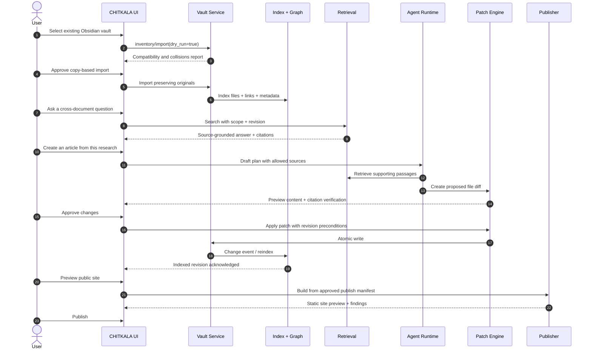

**Definition of success:** no source file is overwritten without approval, citations continue to resolve, and private notes are not implicitly published.

### 3.3 Journey B — Visual thinking

User selects five concept notes → creates a canvas → drags a graph neighborhood onto the canvas → adds handwritten annotation and a Mermaid architecture diagram → links a region of the canvas back to an article heading → requests an agent to produce a summary → reviews proposed article updates. The canvas stores **references to document IDs**, not copies of note bodies.

### 3.4 Journey C — Offline/local LLM

Airplane mode → open vault and retrieve keyword search → edit notes → optionally query a configured *locally running* model → stage and commit edits → queue sync attempts when network returns. If local model is unavailable, the UI states so and retains all non-AI functionality.

### 3.5 Journey D — Skills and permissions

Install a community skill → inspect its manifest and provenance → grant `vault.read` to a named collection → run dry-run with fixed test inputs → review requested `vault.write` action → optionally grant a one-run write permission → track execution trace and revoke permissions later.

---

## 4. 🧩 Feature Inventory & Prioritization

Legend: **M0** = foundations, **M1** = useful alpha, **M2** = intelligent alpha, **M3** = creative beta, **M4** = publishing/agent beta, **M5** = sync/ecosystem.

| Domain | Requirement | Earliest milestone | Dependency |
|---|---|---:|---|
| Vaults | Open/create/copy-import vault, asset browser, undo | M1 | Filesystem core |
| Compatibility | Frontmatter, wikilinks, aliases, embeds, heading/block refs | M1 | Parser + resolver |
| Editing | CodeMirror source view, preview, tabs/stacked panes, undo | M1 | UI shell |
| Document graphs | Backlinks, outgoing links, unlinked references, neighborhood | M1 | Relational edge index |
| Search | FTS5, metadata filters, fuzzy filename matching | M1 | SQLite |
| AI Q&A | Hybrid search, chunk citations, model adapters | M2 | Retrieval + adapters |
| AI creation | Plan, article draft, patch review, atomic write | M2 | Agent + patch service |
| Graph semantics | Concept entities, typed edges, suggested relations | M3 | Graph projection |
| Hypermedia | Markdown/MDX-safe components, sandbox HTML/JS | M3 | Renderer registry |
| Canvas | Node/mind map, Excalidraw-compatible spatial adapter | M3 | Workspace document type |
| Skills | Manifests, tool permissioning, run trace, approval broker | M4 | Agent runtime |
| Publishing | Astro-compatible static export, preview, deployment adapters | M4 | Build sandbox |
| Sync | Encrypted multi-device file sync and version reconciliation | M5 | Identity + sync protocol |
| Collaboration | Yjs-backed live sessions and server persistence | Later | Sync + CRDT strategy |
| Mobile | Reading / light editing | Later | Mobile filesystem abstraction |
| Marketplace | Discovery, package signatures, moderation and compatibility | Later | Stable SDK, governance |
| Books | Book projects (`book.yaml`), numbering, cross-refs, citations, glossary; site/PDF/EPUB builds | K1–K2 (after M4) | Renderer + local publish |
| Knowledge Packs | Signed, versioned `.ckpack` editions; install into a read-only Library; overlays; errata | K3–K4 | Retrieval, publishing |
| Knowledge repositories | Static registries, managed registry, hosted large repositories, "ask this book", medical profile | K5–K7 | Packs, optional AWS services |

> [!note] Textbooks and installable knowledge
> Books, Knowledge Packs, the Library and the medical profile are specified in
> [`CHITKALA_KNOWLEDGE_PACKS_AND_TEXTBOOKS.md`](CHITKALA_KNOWLEDGE_PACKS_AND_TEXTBOOKS.md); the optional AWS
> implementation is in [`AWS/CHITKALA_AWS_ARCHITECTURE.md`](AWS/CHITKALA_AWS_ARCHITECTURE.md) §22.

---

## 5. 🏛️ Architecture Overview

### 5.1 System context

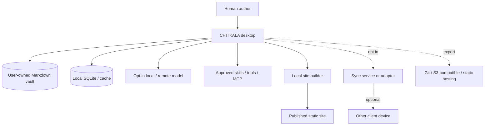

### 5.2 Component architecture and trust boundaries

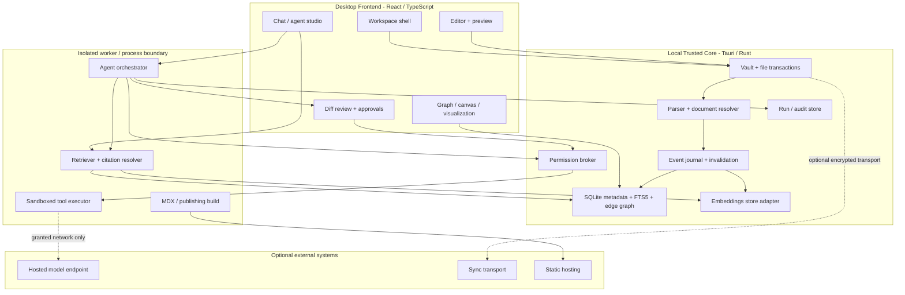

The arrows above represent logical calls. **All external, user-script, and agent tool paths cross policy enforcement** in the trusted core. The renderer never inherits unrestricted filesystem privileges from the desktop shell.

### 5.3 Recommended stack and rationale

| Layer | Recommended baseline | Alternatives | Reason / caveat |
|---|---|---|---|
| Desktop host | **Tauri 2 + Rust** | Electron | Smaller platform shell; Rust access control. Validate packaging and OS behavior |
| Client app | **React + TypeScript + Vite** | SvelteKit | Rich editor/canvas ecosystem, reusable UI |
| UI styling | Tailwind + shadcn/ui + design tokens | Radix primitives, custom CSS | Accessible primitives, customization |
| Docking | Custom pane tree or maintained layout library behind adapter | Golden Layout | Stacked panes and tabs should be portable across themes |
| Source editing | **CodeMirror 6** | Monaco (code-heavy), Lexical (rich editing) | Markdown-first text fidelity and plugin ecosystem |
| Markdown parser | **One Rust parser** (`markdown`/markdown-rs or `comrak`, spike S-R1) + `ammonia` sanitising; CodeMirror Lezer grammar for editing UX only | unified/remark (only inside the MDX worker) | Links, chunks and citations must mean the same thing in desktop, server, Lambda and pack builder (ADR-019) |
| Syntax compatibility | Dedicated Obsidian syntax adapter | Parser customizations | Avoid lossy regex-only conversions |
| Local core | Rust/Tauri commands + **generated** TS bindings (`tauri-specta`) | JS service host | File transactions and permissions; Rust types are the contract (ADR-017) |
| Metadata/index | **SQLite + FTS5** | DuckDB for analytics later | Local transactions, mature search, graph relational tables |
| Vectors | Rust trait: sqlite-vec via `rusqlite` pilot | LanceDB (Rust), tantivy for large lexical packs (S-R2) | sqlite-vec is pre-v1; isolate behind interface |
| Graph display | Cytoscape.js or Sigma.js | D3 custom | Graph exploration/large-network layouts |
| Directed visual flows | **React Flow (`@xyflow/react`)** | Custom SVG | MIT license, editable nodes/edges |
| Whiteboard | **Excalidraw embedded** as optional adapter | Custom open-source canvas | MIT code; check current third-party terms |
| MDX | MDX compiler in **isolated build worker** | Static component AST renderer | Compiled MDX is executable JS; not safe by default |
| Diagrams | Mermaid with restricted/sanitized rendering | Graphviz | Native docs authoring and export |
| Local model | Ollama-compatible endpoint adapter | llama.cpp, other OpenAI-compatible hosts | BYO models; no AI dependency for editing |
| Hosted models | OpenAI-compatible endpoint + provider-specific adapter | Any supported API | Capability discovery, redaction, user consent |
| Agent workflows | Durable state machine in Rust (`chitkala-agents`); Step Functions in the managed cloud | External framework adapters behind the tool contract | Core should not depend on one fast-changing agent SDK |
| Tool protocol | Versioned local tool contract + MCP via `rmcp` (Rust SDK); scripts sandboxed in `wasmtime` | Direct local tools | Standardized capability access with policy guard (ADR-020) |
| Static publishing | **Astro build worker** | Eleventy, custom renderer | Strong Markdown/MDX content publishing |
| Sync | Rust sync protocol + reconciliation (`chitkala-sync`); collaboration later with `yrs` (Rust) ↔ Yjs (editor) | Git, WebDAV, S3 | CRDT collaboration is separate feature |
| Server | **Axum** self-host single binary and **Rust Lambda** handlers over one service layer (ADR-018) | — | Same grants and code in every host; self-host stays in the main repo |
| Telemetry | Optional OpenTelemetry signals; local by default | Structured JSONL | Privacy-respecting traceability |
| Test stack | `cargo-nextest`, `proptest`, `insta`, `criterion`; Vitest, Playwright; cross-language conformance fixtures; `cargo-deny` licence/advisory gate | Others | Browser + core + compatibility coverage |

### 5.4 Dependency licensing flags

- React Flow documents its **MIT** licensing, including commercial use. [Source: React Flow](https://github.com/xyflow/xyflow).
- Excalidraw repository documents an **MIT** license. [Source: Excalidraw](https://github.com/excalidraw/excalidraw).
- **Do not assume tldraw SDK is a drop-in unrestricted open-source choice**: current official docs require a valid production license key. [Source: tldraw licensing](https://tldraw.dev/sdk-features/license-key).
- sqlite-vec documents **pre-v1 / expected breaking changes**. Do not make its table format a public contract. [Source: sqlite-vec](https://github.com/asg017/sqlite-vec).
- Tauri filesystem permissions are scoped and must be configured explicitly. [Source: Tauri FS](https://v2.tauri.app/plugin/file-system/).
- MDX compiles Markdown/JSX to **JavaScript**; evaluating unknown documents in a privileged application renderer is unsafe. [Source: MDX docs](https://mdxjs.com/getting-started/).

### 5.5 Why not start with a distributed microservice architecture?

A single-user local-first app gains little from running many microservices. Start as a **modular monolith** with separable workers and explicit RPC interfaces. Promote specific functions to services only if collaboration, sync or shared publishing usage justifies it. Every cloud component must have a local substitute or graceful feature degradation.

---

## 6. 🗂️ Repository, Vault Layout & Portability

### 6.1 Suggested monorepo layout

> [!note] Superseded
> The Rust-backend layout with the full crate map is in [`CHITKALA_PRIOR_ART_AND_STACK.md` §4](CHITKALA_PRIOR_ART_AND_STACK.md#4-repository-layout). The tree below is the original draft.

```text
chitkala/
├── apps/
│   ├── desktop/                 # Tauri application host
│   ├── web/                     # Shared UI, browser-specific persistence
│   ├── publish-worker/          # Isolated static site builder
│   └── docs/                    # Public docs / development handbook
├── packages/
│   ├── ui/                      # Tokens, shadcn/Radix wrappers, panes
│   ├── domain/                  # IDs, entities, shared schemas
│   ├── editor/                  # CodeMirror extensions / preview
│   ├── markdown/                # AST, wikilinks, embeds, frontmatter
│   ├── graph/                   # Graph query model + views
│   ├── canvas/                  # Canvas schema + adapters
│   ├── retrieval/               # Ranking, chunking, citations
│   ├── agents/                  # Workflow contracts and UX
│   ├── model-sdk/               # Provider abstraction
│   ├── plugin-sdk/              # Manifest + capability APIs
│   ├── publish/                 # Asset pipeline, theme kit
│   ├── sync-protocol/           # Wire types + conflict contracts
│   └── test-fixtures/           # Golden vaults / stress fixtures
├── crates/
│   ├── chitkala-core/           # Commands, vault registry
│   ├── chitkala-files/          # Atomic writes, watchers, backups
│   ├── chitkala-index/          # SQLite FTS/metadata/edges
│   ├── chitkala-policy/         # Capability decisions and auditing
│   └── chitkala-sync/           # Optional sync adapter core
├── schemas/                     # JSON Schema, OpenAPI, SQL, migrations
├── examples/                    # Example vault, skill, renderer
├── tests/                       # E2E, fuzz/property, benchmark suites
├── scripts/                     # Dev/bootstrap/release automation
├── .github/                     # CI, templates, security scanning
├── LICENSE
├── CONTRIBUTING.md
├── SECURITY.md
├── CODE_OF_CONDUCT.md
├── GOVERNANCE.md
└── README.md
```

### 6.2 User vault format

```text
My Knowledge Vault/
├── Articles/
│   ├── Agentic AI Gateways.md
│   ├── RAG Retrieval Strategies.md
│   └── Architecture with Interactive Visuals.mdx
├── Projects/
│   ├── Ananke/
│   └── Vichara/
├── Canvas/
│   ├── Research Constellation.canvas.json
│   └── Workflow Thinking.excalidraw.json
├── Attachments/
│   ├── retrieval-chart.svg
│   └── architecture.png
├── Templates/
├── .obsidian/                    # preserved, not treated as trusted code
└── .chitkala/
    ├── vault.json               # portable, non-secret settings
    ├── ids.json                 # optional stable ID sidecar
    ├── publish.yaml             # explicit public-content policy
    ├── skills/                  # user-reviewed skill descriptors
    └── cache/                   # safe to delete; index may live in OS appdata
```

**Important:** tokens, credentials, encryption keys, device identifiers and sensitive execution traces **do not belong in portable, auto-published vault content**. Store them via platform credential storage / user-controlled encrypted secret vault. Large caches should default to OS application data, excluded from sync and Git.

### 6.3 Document identity

Use opaque `document_id` (UUIDv7 or ULID) independent of filename and title. Store IDs in frontmatter **when the user opts in**; otherwise use `.chitkala/ids.json` mapping resolved path + content fingerprints to stable IDs. An import must not rewrite documents merely to add IDs without preview/approval.

On rename: update document path and incoming wikilinks transactionally where enabled. On content move: preserve ID. On duplicate import: determine whether content represents fork or same document; do not silently merge based only on matching title.

### 6.4 Markdown document example

```yaml
---
chitkala_id: "01K9EXAMPLE7B0Q3XYZ"
title: "Retrieval Engineering for RAG"
aliases: ["RAG Retrieval"]
tags: [rag, retrieval, architecture]
status: draft
visibility: private
updated: 2026-10-20
---
```

Then ordinary Markdown including `[[Knowledge Graph#Typed Edges]]`, `![[Attachments/retrieval-chart.svg]]`, fenced Mermaid, math and semantic metadata remains readable from other Markdown editors.

### 6.5 Supported content formats

| Format | Editing | Preview | Search/graph extraction | Publish |
|---|---|---|---|---|
| `.md` | Native P0 | Native P0 | P0 | P0/M4 |
| `.mdx` | Source P0, safe preview M3 | Trusted-components M3 | Markdown text + component metadata | Trusted build M4 |
| `.html` | Source P0 | Sandboxed preview M3 | Sanitized visible text + links | Opt-in restricted M4 |
| `.js` / `.ts` | Source editor | Only in isolated preview environment | Code-symbol search optional | Explicit trusted bundle only |
| `.canvas` / `.canvas.json` | Canvas editor M3 | Native M3 | Semantic references | Snapshot/interactive export |
| `.svg` | Source and image | Sanitized/sandboxed | Links/alt text | Sanitized assets |
| Images/audio/PDF | Attachment | Native/safe viewers | Metadata; OCR/transcription opt-in | Allowlisted assets |
| `.ipynb` | Import/read adapter later | Sandboxed outputs | Markdown/code cells | Sanitized export |

**Never equate “supports HTML/JavaScript” with “executes arbitrary scripts with vault privileges.”** Those are separate feature tiers controlled by trust, provenance and permissions.

---

## 7. ✍️ Document Editing, Hypermedia & Rendering

### 7.1 The canonical content pipeline

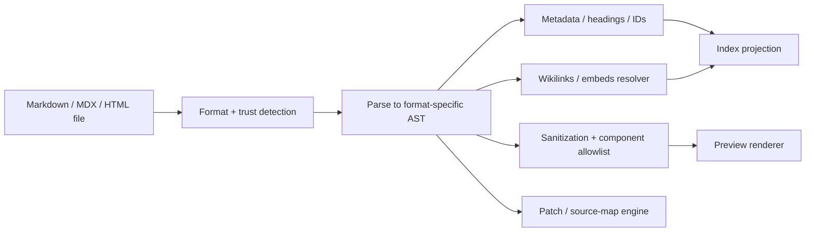

Retain original whitespace and Markdown syntax wherever possible; AST transformations should avoid gratuitous source reformatting. Keep editor state (selection, undo stack, scroll position) separate from disk documents.

### 7.2 Editor feature checklist

**P0:** CodeMirror source mode, line numbers optional, split preview, autocomplete for wikilinks/headings/tags, autosave, transactional rename, heading outline, blockquote/callout rendering, Mermaid and math, image paste with safe filename generation, code fencing, undo/redo, tabbed and stacked pages.

**P1:** visual block mode, structured metadata forms, table editing, MDX component completion, cross-document block references, inline source citations, live data cards, AI selection actions.

**P2:** reusable knowledge components, interactive data visualizations, parameterized snippets, component registry, notebook-style cells under an explicit sandbox.

### 7.3 Backlinks and references

Extract link types:

- Wikilinks: `[[Page]]`, `[[Page#Heading]]`, `[[Page|Label]]`.
- Markdown: `[label](relative-path.md)` including fragments.
- Embeds: `![[Page]]`, images and named blocks.
- Frontmatter: references and tags from registered schemas.
- Semantic edges: manually created or AI-suggested relations (`supports`, `contradicts`, `depends_on`, etc.).

Maintain **normalized target IDs**, the original textual link, offsets/source map, link status (resolved/ambiguous/broken) and revision. UI should distinguish exact links from probabilistic AI-inferred links.

### 7.4 MDX and arbitrary HTML policy

**Tier 0 — Safe Markdown (default):** no arbitrary JavaScript or HTML event handlers; sanitize to approved tags/attributes; block `javascript:` URLs and unsafe resources.

**Tier 1 — Trusted CHITKALA components:** imports from a signed/versioned local registry; no network or filesystem access unless individually permitted. For example, `<KnowledgeGraph topic="rag" />`, `<MindMap src="..." />`, `<MermaidDiagram ... />`, `<MetricCard ... />`.

**Tier 2 — Sandboxed interactive artifacts:** user-authored JavaScript rendered inside a distinct iframe/origin or tightly isolated webview; CSP, restricted postMessage API, network deny by default. Prefer isolated subprocess + browser sandbox for builds. No Node.js APIs, no direct Tauri bridge, no privileged cookies or access tokens.

**Tier 3 — Trusted developer extension:** explicit install and signature/provenance inspection; capabilities exposed only through the policy broker. Plugin UI runs in isolated extension host; high-risk tasks execute out-of-process.

> [!danger] Avoid a common trap
> An MDX compiler produces executable JavaScript. AST validation alone is not a complete sandbox. Do **not** `eval`, dynamic-import, or run untrusted compiled MDX in the privileged CHITKALA app origin. Segregate trust domains at the execution boundary.

### 7.5 Renderer registry contract (illustrative TypeScript)

```ts
export interface RendererManifest {
  id: string;              // e.g. "org.chitkala.mermaid"
  version: string;         // SemVer
  formats: string[];      // ["markdown/fence:mermaid"]
  integrity?: string;      // bundle hash
  entrypoint: string;
  sandbox: "static" | "isolated-frame" | "isolated-worker";
  requiredCapabilities: Capability[];
}

export interface RenderRequest {
  vaultId: string;
  documentId: string;
  revision: string;
  source: string;
  format: string;
  options: Record<string, unknown>;
}
```

### 7.6 Embedded web/JavaScript behavior

For ordinary imported articles: render static HTML/MDX safely; strip executable scripts. For trusted interactive articles: compile with a controlled component registry and issue a preview token **limited to named assets and API methods**. Public publishing includes *only* explicitly approved interactive components, with a per-site content-security policy.

---

## 8. 🕸️ Knowledge Graph, Backlinks & Semantic Modeling

### 8.1 Three distinct graphs

1. **Document graph:** explicit Markdown links and embeds. Deterministic, rebuildable.
2. **Semantic entity graph:** concepts, definitions, people/projects/topics and typed relations. May require user review.
3. **Agent provenance graph:** which sources, tools and decisions produced an output. Append-only audit metadata.

Do not mix these into one undifferentiated cloud of dots. Different edge trust and provenance must be visible.

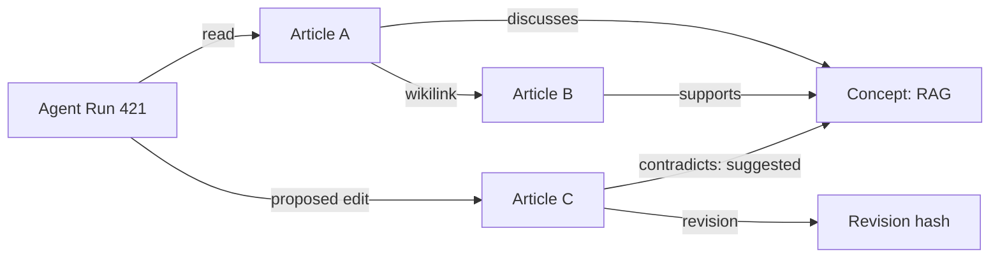

### 8.2 Data and queries

A minimal graph needs `nodes`, `edges`, `document_revisions`, `source_spans`, and `edge_evidence`. Store exact source/target IDs, types, provenance (`manual`, `parsed`, `agent_suggested`), confidence and validation status. Support 1-hop neighborhood, k-hop with limits, inbound/outbound links, connected components, orphan notes, dangling references, graph search and path explanations.

**Do not start with Neo4j.** For a personal vault, indexed relational edge tables are simpler and usually sufficient. Add a graph database adapter only if measured traversal/query requirements warrant it.

### 8.3 Knowledge graph UX

- Graph overview: neighborhood-first, zoom and filters, not a million-node hairball.
- Node styling: distinct shapes/colors for note, concept, task, agent, source, canvas.
- Edge styling: explicit link vs inferred relationship vs provenance.
- Hover: title, snippet, tags, incoming/outgoing counts, source type.
- Click: open in adjacent pane, keep previous panes accessible.
- Context menu: create relationship, pin, generate mindmap, ask about neighborhood.
- Provenance mode: visualize the lineage of an agent-generated article.

### 8.4 Stable positions and performance

Cache graph layouts by filter + graph revision. Materialize local neighborhoods in a worker. Use level-of-detail, node budgets and progressive expansion. Index source/target columns, avoid unbounded recursive graph traversals in interactive UI.

---
## 9. 🧠 Search, Retrieval, Memory & RAG

### 9.1 Layered search strategy

Do not equate vector search with all retrieval. Use a staged, transparent retrieval pipeline:

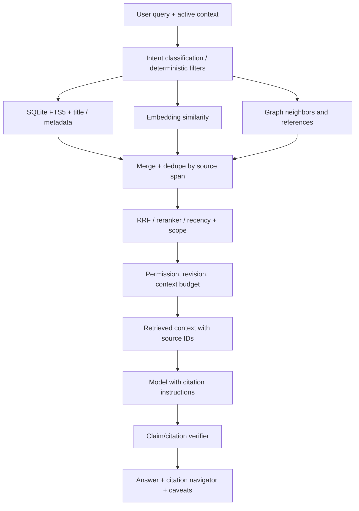

### 9.2 Retrieval modes

| Mode | Approach | When to use |
|---|---|---|
| Navigation | Title/path alias and fuzzy search | Open a known note quickly |
| Lexical | FTS5 BM25-style ranking | Exact terms, rare tokens, identifiers |
| Semantic | Local vector similarity | Paraphrase and conceptual similarity |
| Hybrid | Rank fusion, then optional rerank | Default natural language Q&A |
| Graph-aware | Neighbors, edges, shared concepts | Multi-document relationships |
| Structural | Heading, section, property and date filters | Precise scoped extraction |
| Temporal | Revision history or date filters | What changed, progression of ideas |
| Provenance | Agent run / source lineage filters | Why this generated content exists |

SQLite FTS5 supports full-text queries and relevance ranking via `rank` / `bm25()`; see [SQLite FTS5 documentation](https://sqlite.org/fts5.html). Vector search should be optional and degradable, not a startup blocker.

### 9.3 Ingestion and chunking

**Input event:** `document.changed(vault_id, document_id, revision, changed_ranges)`.

1. Read committed file content, validate size/MIME and exclude privacy-filtered paths.
2. Parse frontmatter, title, sections, links, citations, code fences, tables, math and metadata.
3. Split by Markdown headings first; preserve tables, code fences and block references as atomic chunks when possible.
4. Apply bounded size overlap **within the same logical section**; avoid blindly merging unrelated sections.
5. Assign stable chunk anchors: `document_id + section_anchor + local span + content_hash`.
6. Upsert lexical fields and exact link edges transactionally.
7. Queue embeddings asynchronously with model/version/policy metadata.
8. Remove obsolete chunks/edges after new revision commits and refresh retrieval revision watermark.
9. Emit `index.document.ready` only once a coherent committed search projection is visible.

**Default chunking proposal:** heading-aware chunks with target ~350–650 tokens, maximum ~900 tokens, overlap ~50 tokens when necessary. These are starting values for evaluation, not universal best practices. Split large code or tables according to syntax-aware rules and preserve references.

**Embedding version policy:** record model ID, dimensionality, normalization, creation time and document revision. A changed embedding model triggers a **new index namespace** and progressive reembedding; never compare vectors from incompatible spaces.

### 9.4 Query planning and ranking

Retrieve using lexical and vector channels independently. Use **Reciprocal Rank Fusion (RRF)** for a transparent default; optionally rerank the merged top-k with a small model. Apply permission/source-type filters **before** retrieval and repeat them before prompt assembly. Resist leakage from excluded directories through cached embeddings or summaries.

Illustrative RRF formula:

\[
\operatorname{RRF}(d)=\sum_{r\in \text{retrievers}}\frac{w_r}{k+\operatorname{rank}_r(d)}
\]

Tune weights, `k`, top-N limits and reranking experimentally. Include maximum token budgets and timeout/fallback behavior.

### 9.5 Citations and evidence

A source citation is a **machine-verifiable location**, not merely an LLM-written hyperlink.

```ts
export interface SourceCitation {
  vaultId: string;
  documentId: string;
  revision: string;          // content hash or revision ID
  chunkId: string;
  headingPath: string[];
  startByte: number;         // UTF-8 canonical content offset
  endByte: number;
  quotedTextHash: string;
  displayPath: string;
}
```

On click: resolve document ID → revision → section/span → highlight matching text. If the file changed, indicate *“citation refers to an older revision”*, attempt offset relocation by text hash, and offer to view saved revision. Do not quietly point to an unrelated paragraph.

### 9.6 Memory taxonomy

| Memory | Stored where | Control / lifecycle |
|---|---|---|
| Source documents | Canonical Markdown files | User ownership, edit/delete |
| Working context | Per-conversation state, bounded | TTL and manual clear |
| Summaries | Sidecar Markdown or explicit generated artifact | User-reviewable, versioned |
| Preferences | Named settings or user-approved profile | Opt in, inspect/delete |
| Semantic memory | Embedding index derived from content | Rebuildable, excluded scopes honored |
| Agent experience | Traces + evaluation results | Policy retention, reviewable |
| Knowledge graph | Explicit links + derived projections | Edge provenance and user override |

**Never** treat an agent's unverified observation as a confirmed personal fact. Derived memory must reference sources and have deletion propagation semantics.

### 9.7 Quality and evaluation

Build a benchmark corpus from consented sample vaults and synthetic fixtures. Use hand-verified Q&A pairs, ambiguous link cases, citation exactness cases, partial-data questions and adversarial instructions embedded in notes. Score recall@k, nDCG@k, MRR, groundedness, unsupported claims, exact citation resolution, permission leakage, latency and token cost. Capture results by model/provider/embedding version. Golden tests should fail if a tool can bypass document scopes or if missing evidence is fabricated.

### 9.8 When AI creates an article

The agent must mark each paragraph as **user-supplied**, **source-supported synthesis**, **general model knowledge**, or **unsupported draft to verify** at proposal time. Publish only after human review; avoid inventing citations. The source citations and a generated-content provenance summary should be accessible from the editor even if not all metadata is included in public Markdown.

---

## 10. 🤖 Agent Architecture, Skills & Tool Execution

### 10.1 Execution philosophy

An agent is a **bounded workflow actor**, not a privileged operator. Design agents around explicit inputs, capabilities, resource scopes, budgets, checkpoints and observable outputs. Natural-language instructions alone are not an authorization system.

### 10.2 Agent layers

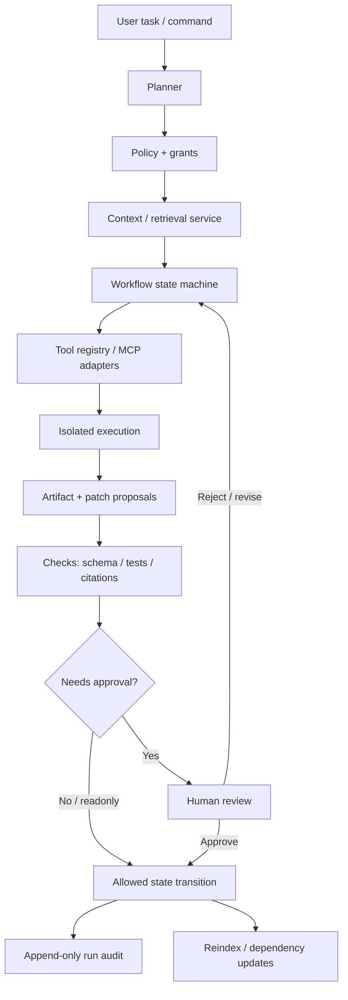

### 10.3 Agent runtime state machine

`CREATED → PLANNED → WAITING_PERMISSION → RUNNING → PROPOSAL_READY → WAITING_REVIEW → COMMITTING → COMPLETED`

Alternative terminal states: `CANCELLED`, `FAILED`, `EXPIRED`, `REJECTED`. Transitions must be validated server/core-side. Persist checkpoints at every externally visible transition. Idempotency keys prevent duplicate side effects after retries. Tool timeouts must propagate cancellation and resource teardown.

### 10.4 Standard agents (future templates, not pre-enabled autonomy)

| Agent | Inputs | Output | Default privileges |
|---|---|---|---|
| Researcher | Question, scope | Source-grounded research memo | Read selected vault content |
| Writer | Brief, sources, outline | Draft `.md` / `.mdx` patch | Read + propose, no direct commit |
| Knowledge Curator | Vault subset | Tags, aliases, links, orphan suggestions | Read + suggest metadata |
| Diagram Artist | Concepts, selected notes | Mermaid / SVG / canvas proposal | Read + propose asset |
| Reviewer | Document + constraints | Quality checks / citation gaps | Read only |
| Architect | Specs and repo metadata | ADR/diagram/API sketches | Read + propose |
| Publisher | Approved selected documents | Publish manifest + build preview | Build locally; no push without approval |
| Planner | Goals/notes | Task graph / prioritized roadmap | Read + propose task mutations |
| Migration Assistant | Source vault | Compatibility and conversion patches | Filesystem scoped, dry-run first |

### 10.5 Skill manifest

Skills describe **capabilities and reusable instructions**. They may call registered tools, but skill prose never expands permissions. Declare dependencies and compatibility.

```yaml
apiVersion: chitkala.dev/v1alpha1
kind: Skill
metadata:
  id: org.chitkala.write-research-article
  name: Research Article Writer
  version: 0.1.0
  author: CHITKALA contributors
spec:
  description: Draft a source-grounded Markdown article
  entrypoint: skills/article-writer/SKILL.md
  inputSchema: schemas/article-request.json
  outputSchema: schemas/article-proposal.json
  requiredCapabilities:
    - action: vault.read
      scope: user-selected-documents
    - action: index.query
      scope: user-selected-vault
    - action: patch.propose
      scope: drafts/**
  approvalPolicy: always-before-write
  budgets:
    maxWallTimeSeconds: 180
    maxToolCalls: 30
    maxOutputTokens: 12000
  compatibility:
    chitkala: ">=0.3.0 <1.0.0"
```

### 10.6 Tool and MCP contract

Expose a normalized tool registry for `vault.read`, `vault.search`, `graph.neighbors`, `note.propose_patch`, `diagram.render`, `publish.preview`, etc. MCP servers are adapters—not privileged exceptions. The broker validates tool metadata, schema, permissions, origin, timeout, quota and allowed destinations; it sanitizes tool outputs and records provenance. Be attentive to untrusted MCP server descriptors and tool-result injection. See [OWASP MCP Security Cheat Sheet](https://cheatsheetseries.owasp.org/cheatsheets/MCP_Security_Cheat_Sheet.html).

### 10.7 Permission model

Each grant is the intersection of **principal + action + resource scope + conditions + expiration**:

```json
{
  "grant_id": "grant_01KEXAMPLE",
  "principal": "skill:org.chitkala.write-research-article",
  "action": "vault.read",
  "resources": ["vault:v1/Articles/**"],
  "constraints": {"exclude": ["**/Private/**"], "network": false},
  "expires_at": "2026-10-21T02:00:00Z",
  "approval_mode": "per_run"
}
```

For sensitive actions—delete, shell execution, public publish, external upload, spending money, bulk changes—require specific visible confirmation. **Do not** let a model construct a privileged API call by simply writing JSON that happens to look like an authorized action; authorization occurs separately in the core.

### 10.8 Patch-based mutations

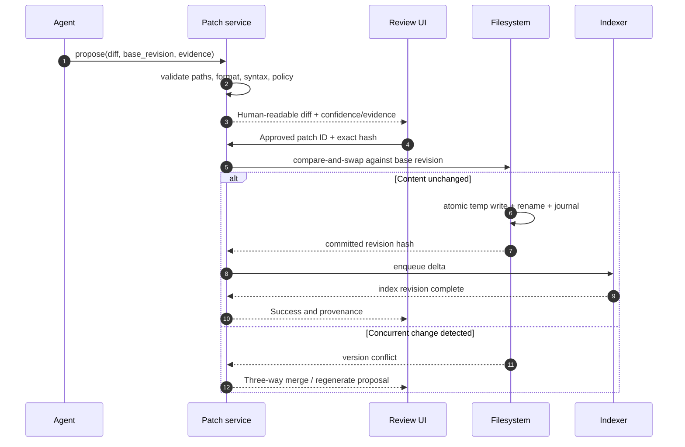

Patch validation includes permission check, path normalization, symlink resolution, file size quota, syntax validation, filename allowlist, frontmatter consistency, and citation locator validation. Keep before/after revisions for recovery.

### 10.9 Agent evaluation harness

Evaluate distinct axes: task success, source fidelity, citation resolution, patch correctness, forbidden-side-effect rate, tool efficiency, cost, latency, and user acceptance. Integration points can support frameworks such as MLflow and optional external evaluator SDKs while retaining a stable internal evidence model. Store evaluations with run input snapshot, dataset version, evaluator version and model metadata.

### 10.10 Agent ↔ Ananke boundary

CHITKALA can integrate with **Ananke** as an **optional code-engineering agent harness**, not a hard dependency. A separate connector exchanges structured task manifests, tool requests, test artifacts, policy decisions and patch bundles. CHITKALA stays responsible for vault permissions, knowledge provenance and user-visible review.

---

## 11. 🎨 Canvas, Mind Maps & Visual Intelligence

### 11.1 Canvas types

- **Knowledge canvas:** notes, links, concepts and groups represented as referenced nodes.
- **Mind-map canvas:** hierarchical or radial ideas; can export as nested Markdown outline.
- **Flow canvas:** React Flow nodes for workflows, agent chains and system design.
- **Freeform canvas:** optional Excalidraw-style pen/drawing adapter with safe static snapshots.
- **Dashboard canvas:** typed visual widgets (charts, tables, metrics) consuming approved local data queries.

### 11.2 Canvas data model (separate from source documents)

```json
{
  "schemaVersion": 1,
  "canvasId": "can_123",
  "title": "RAG Research Map",
  "nodes": [
    {
      "id": "node_1",
      "type": "document-ref",
      "ref": {"documentId": "doc_abc", "heading": "Hybrid Retrieval"},
      "x": 120,
      "y": 180,
      "width": 320,
      "height": 210
    }
  ],
  "edges": [],
  "styles": {"theme": "aurora"},
  "revision": "sha256:example"
}
```

`ref.documentId` gives stable identity across file rename. If referenced content is deleted, show a broken-reference placeholder; never silently duplicate historical content as if current.

### 11.3 Graph-to-canvas synchronization

Canvas placement is user-authored spatial state. The graph is a queryable relationship projection. Dragging a note from graph to canvas creates a reference node. Adding a drawn connector **does not automatically create a factual semantic edge**; the user must choose whether it is presentation-only or a persistent typed relationship.

### 11.4 Visual export

Provide SVG/PNG for diagrams, PDF print via browser rendering (later), JSON scene exports, and markdown-embedded interactive references. Preserve editability where possible and include accessible textual alternatives. Exported SVG must be sanitized before publishing.

---

## 12. 🧱 Data Storage, Schema & Event Processing

### 12.1 Authoritative vs derived storage

| Store | Authoritative? | Contains | Recovery |
|---|---|---|---|
| Vault `.md` / `.mdx` / assets | **Yes** | User content | Backup/version history |
| Vault explicit metadata manifests | **Yes** | IDs, user tags/settings, canvas structure, publish rules | Backed up with vault |
| OS keychain/secrets | **Yes** | Credentials / encryption keys | Credential recovery flow |
| SQLite primary cache | No for document bodies; yes for ephemeral run state unless archived | FTS, graph, jobs, UI state | Rebuild; persist run log safely |
| Vector index | No | Embeddings and chunk pointers | Recompute from canonical source |
| Agent audit archive | **Yes for audit** | Grants, proposals, outcomes and run metadata | Explicit backup/retention strategy |
| Remote sync blob store | Replica | Encrypted documents/objects | Reconcile version history |
| Public site output | No | Generated HTML/assets | Rebuild from publish manifest |

### 12.2 Logical relational model

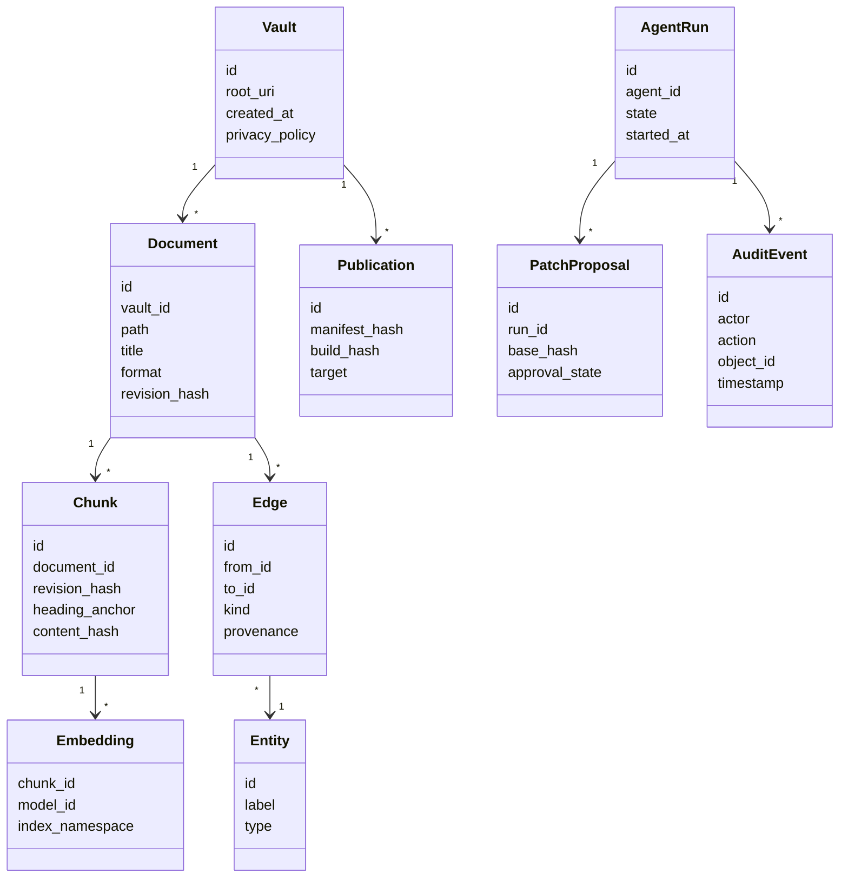

See the companion `schema.sql` for starter DDL. It is a **design seed**, not a tested production migration.

### 12.3 Change propagation

Local file watcher events can arrive duplicated, coalesced or out of order. Canonicalize path, debounce short bursts, compute content hash, ignore unchanged hashes, serialize writes per-document and use transactional index mutations. For large vaults, cap worker concurrency to prevent CPU/IO overload. On startup, compare journal sequence + current filesystem manifest; scan for missed changes during downtime.

### 12.4 Event envelope

```json
{
  "eventId": "evt_01KEXAMPLE",
  "eventType": "document.committed",
  "schemaVersion": 1,
  "vaultId": "vault_123",
  "aggregateId": "doc_abc",
  "revision": "sha256:content_hash",
  "causationId": "patch_456",
  "correlationId": "run_789",
  "occurredAt": "2026-10-20T21:00:00Z",
  "payload": {"path": "Articles/RAG.md", "format": "md"}
}
```

**Events are delivery signals**, not the canonical history of file contents. Consumers must be idempotent by `(document_id, revision, projection_name)` and must tolerate replay.

### 12.5 Compaction, backups and retention

- Use SQLite WAL and explicit integrity checks; checkpoints tuned to workload.
- Periodic snapshot + journal for in-flight drafts; atomic safe-write with OS-specific durability testing.
- Hash-address attachments for deduplication only when it does not break user-visible paths.
- Backups include vault manifests and revision snapshots; indexes are optionally excluded.
- Support “rebuild all indexes” command and diagnostic report.
- Delete paths must remove vectors, chunk caches and derived summaries; honor user-requested scope exclusions.
- Keep audit events for a documented retention window; redact sensitive prompt data by default.

---

## 13. 🔌 APIs, IPC & Extension Contracts

### 13.1 Interface conventions

1. Local desktop uses typed **Tauri command IPC**; shared domain types describe request and response payloads.
2. Optional self-hosted server uses REST/JSON for standard operations, SSE for run event streams, WebSocket only for real-time collaboration/sync negotiation when required.
3. Use `/v1` external API path, `schemaVersion` inside durable artifacts, SemVer for packages.
4. API mutators take idempotency keys and revision preconditions; responses include stable identifiers.
5. Error model is structured: `code`, `message`, `details`, `requestId`, `retryable`.
6. No external API endpoint should bypass the same capability authorization checks as desktop IPC.

### 13.2 High-level API surface

| Operation | Desktop contract | Optional HTTP equivalent |
|---|---|---|
| Scan/import vault | `vault.scan`, `vault.import` | `POST /v1/vaults/imports` |
| List/read documents | `documents.list`, `documents.read` | `GET /v1/vaults/{id}/documents` |
| Stage edit | `patches.propose` | `POST /v1/patches` |
| Approve/apply | `patches.approve`, `patches.apply` | `POST /v1/patches/{id}/apply` |
| Search | `search.query` | `POST /v1/search` |
| Retrieve graph | `graph.neighbors` | `GET /v1/graph/neighbors` |
| Start agent run | `agents.start` | `POST /v1/agent-runs` |
| Observe agent run | local event emitter | `GET /v1/agent-runs/{id}/events` SSE |
| Publish preview | `publish.preview` | `POST /v1/publications/previews` |
| Publish deploy | `publish.deploy` | `POST /v1/publications/deployments` |
| Sync state | `sync.status` | `GET /v1/sync/status` |

### 13.3 Example: safe patch proposal request

```json
{
  "vaultId": "vault_123",
  "documentId": "doc_abc",
  "baseRevision": "sha256:original",
  "operation": "replace-section",
  "target": {"headingAnchor": "hybrid-retrieval"},
  "newMarkdown": "## Hybrid Retrieval\n\nLexical and semantic retrieval...",
  "evidence": [{"documentId": "doc_source", "revision": "sha256:source"}],
  "origin": {"type": "agent", "runId": "run_789"}
}
```

A patch preview is durable until expiration, rejection or commit. The proposal must never hold a hidden network action disguised as a content edit.

### 13.4 Search response contract

```ts
export interface SearchRequest {
  vaultId: string;
  query: string;
  mode: "lexical" | "semantic" | "hybrid" | "graph";
  filters?: {tags?: string[]; paths?: string[]; modifiedAfter?: string};
  limit: number;
  includeCitations: boolean;
}

export interface SearchHit {
  documentId: string;
  chunkId?: string;
  revision: string;
  title: string;
  path: string;
  heading?: string;
  score: number;
  scoreComponents?: Record<string, number>;
  citation?: SourceCitation;
}
```

### 13.5 Agent run event types

`agent.run.started`, `agent.plan.ready`, `agent.tool.requested`, `agent.tool.completed`, `agent.patch.proposed`, `agent.approval.required`, `agent.run.completed`, `agent.run.failed`, `agent.run.cancelled`. Stream events have monotonically increasing run-local sequence numbers so reconnects can request events after a cursor.

### 13.6 Plugin ABI and isolation

A stable JavaScript-facing extension API must be smaller than the internal application API. Expose permissioned facades (read note, register view, register command, subscribe to scoped events, propose patch) rather than `window.__TAURI__`, raw filesystem, database handles or arbitrary Node.js builtins. Consider WebAssembly/WASI for deterministic sandboxed computation; do not infer security solely from packaging language.

---

## 14. ☁️ Sync, Collaboration & Multi-Device Architecture

### 14.1 Treat three products as three problems

- **Backup:** durable historical copies, often one direction.
- **Sync:** propagate latest file edits across personal devices with conflicts and tombstones.
- **Collaboration:** multiple authors edit the *same document simultaneously*.

Combining these too early produces data loss and a much harder architecture. Deliver separate contracts and test plans.

### 14.2 Personal sync — proposed mechanism

**MVP/M5:** each device maintains a local vault and per-file revision ledger. Device commits create `content_hash`, parent revision(s), device ID, logical timestamp and immutable change manifest. Sync adapter transfers encrypted manifests and content-addressed objects. A deterministic reconciliation algorithm handles renames, creations, deletions and conflicts. Conflict-free transfers fast-forward; divergent file edits trigger a three-way merge where safe or create clearly named conflict copies requiring review.

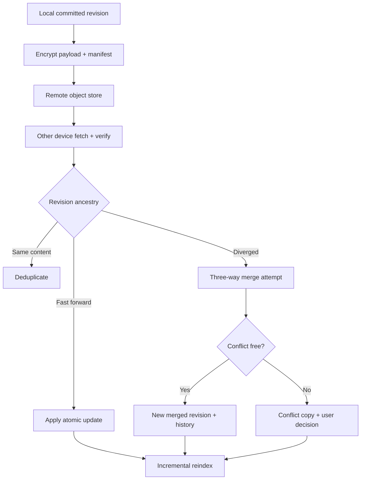

### 14.3 Encryption and key management

Use a vetted authenticated encryption library and device key-management library, not handwritten cryptography. Define: per-vault encryption key, key wrapping for devices, nonce strategy, secure random generation, recovery key, explicit device revocation and rotation, encrypted metadata scope, and threat model for remote storage. E2EE means the relay **cannot decrypt vault bodies**; it does not necessarily hide traffic metadata (object counts, sizes, activity times). Avoid marketing claims until independent tests and audits exist.

### 14.4 WebDAV / Git / S3-compatible adapters

File synchronization adapters differ substantially: Git supports reviewable history but has poor concurrent rich editing UX; WebDAV offers broad hosting compatibility but often lacks strong atomic multi-file transaction semantics; S3-compatible storage supports immutable objects and conditional writes but requires a protocol above raw buckets. Provide adapters behind a common reconciliation engine rather than pretending they share identical conflict guarantees.

### 14.5 Real-time collaboration: separate CRDT design

When building synchronous multi-user editing, use **Yjs** or an equivalent CRDT inside active editing sessions. Yjs documents encode commutative/idempotent updates and provide offline persistence options; see [Yjs update docs](https://docs.yjs.dev/api/document-updates) and [offline support](https://docs.yjs.dev/getting-started/allowing-offline-editing).

**Bridge to Markdown canonical files:** while a document is in live collaborative mode, CRDT state and update log are the source of truth for the **active session**. A controlled checkpoint writer periodically produces canonical Markdown snapshots and corresponding revision records, with one serialization policy. External filesystem edits during an active CRDT session must be imported as a distinct operation/revision or lead to a visible merge prompt—never silently race a separate file watcher write. Shared cursors/presence are ephemeral.

The protocol must protect against replay, malicious client payloads, permission changes mid-session and device clock skew. Test offline concurrent rename/delete/edit cases explicitly.

### 14.6 Multi-tenant SaaS later

If an optional hosted service becomes necessary: separate organization/workspace/vault identities, tenant-scoped encryption keys, row-level access checks and rate limits. No single service account should authorize arbitrary vault operations. Design the **local edition to remain complete without the managed service**.

---

## 15. 🌐 Publishing, Astro & Shareable Knowledge Sites

### 15.1 Publishing goals

Support Obsidian Publish-like outcomes with significantly more control: selected documents, backlinks, navigation, search, themes, internal/external links, diagrams and approved interactive components. Generating a website is a build step, not a live exposure of the local vault.

### 15.2 Proposed publishing pipeline

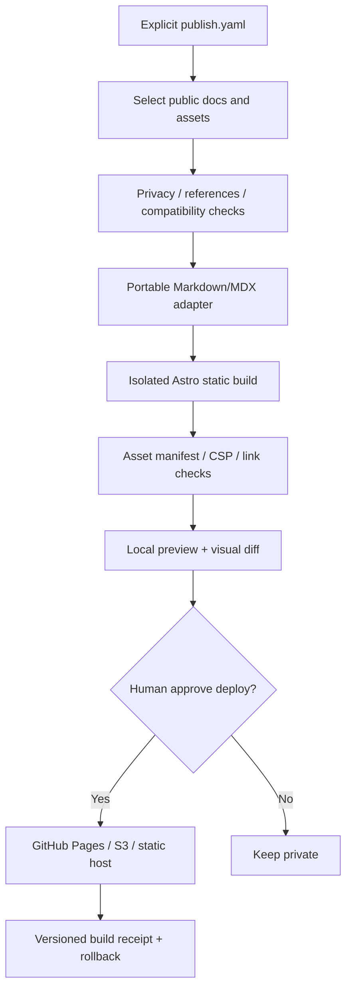

### 15.3 Astro design

Generate or mount a sanitized content export into an Astro site project with typed content collections. Astro supports Markdown/MDX content collections and build-time loaders; see [Astro content collections](https://docs.astro.build/en/guides/content-collections/) and [Astro MDX integration](https://docs.astro.build/en/guides/integrations-guide/mdx/). Validate the Astro version and adapter API at implementation time; avoid pinning an unverified package version in the design.

**Modes:** static export is the default and should run without a CHITKALA account. Optional advanced deployments may add server-side dynamic features behind a separate consented server application, not by shipping personal vault credentials to the client.

### 15.4 Publish manifest example

```yaml
schemaVersion: 1
site:
  title: "CHITKALA Research Notes"
  baseUrl: "https://example.org/notes"
  theme: aurora
content:
  include:
    - "Articles/Published/**"
  exclude:
    - "**/Private/**"
    - "**/*.secret.*"
  defaultVisibility: private
rendering:
  mdxTrustedComponentRegistry: "registry/public-components.lock.json"
  allowInlineScripts: false
  allowUnknownHTML: false
assets:
  stripEXIF: true
  rejectRemoteEmbedsByDefault: true
deploy:
  provider: github-pages
  approval: always
```

**Private-by-default:** frontmatter `visibility: public` alone does not override the explicit publish allowlist. Validate attachments, hidden frontmatter, local absolute paths, draft cross-links, comments, transclusions, code sample credentials and metadata before release.

### 15.5 Public search, graphs and backlinks

Generate a public-only index and public-only graph—**never reuse an unfiltered private vector or lexical index**. For static websites, ship a bounded lexical search index or partitioned client-side index; hosted semantic queries are an optional service with independent cost/privacy policies. Ensure every public graph edge points to public content or is removed/marked as unavailable without revealing secret titles.

### 15.6 Hosting adapters

- **GitHub Pages:** zero/low infrastructure entry for static content; build artifacts pushed via GitHub Actions/repository, respecting hosting limits.
- **Cloudflare Pages / Netlify / Vercel:** optional hosted static/CDN providers; examine plan terms and CI minutes.
- **S3-compatible object store + CDN:** scalable self-host/admin route with infrastructure setup.
- **Local HTML export:** works offline; portable folder you can host anywhere.

Do not require users to purchase CHITKALA publishing services to export a website.

---

## 16. 🎛️ UX Architecture & Design System

### 16.1 Workspace composition

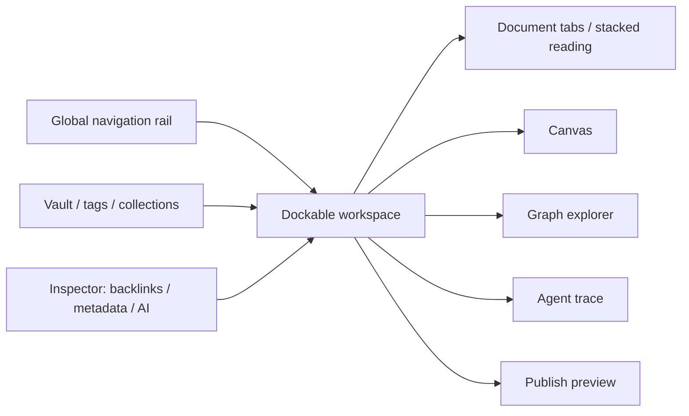

Support Obsidian-inspired **stacked page reading** as a first-class dock layout: a series of narrow document columns/tabs that can open adjacent pages, switch focus, keep context, and close without losing the browsing trail.

### 16.2 Named app sections

| Space | Why it exists | Signature interactions |
|---|---|---|
| Home Universe | Launchpad | Recent knowledge, pinned goals, active tasks, agent activity |
| Library | Manage content and installed books | Files, folders, tags, metadata, import; browse registries, install/update/remove Knowledge Packs |
| Document Studio | Think and write | Source/preview, diffs, citations, stacked pages |
| Graph Explorer | See relationships | Neighborhood, paths, semantic edges, filters |
| Canvas Studio | Spatial thinking | Cards, whiteboards, mindmaps, diagrams |
| Intelligence | Ask and synthesize | Scope picker, source citations, traces |
| Agent Studio | Orchestrate | Skills, runs, approvals, budgets, event logs |
| Planner | Turn knowledge into action | Projects, goals, tasks, timelines |
| Publishing | Share consciously | Site preview, allowlist, deployment records |
| Settings | Keep control | Models, sync, capabilities, export, telemetry |

### 16.3 Design tokens

**Aurora (recommended default):** deep navy background `#0B0E18`, surface `#121828`, raised surface `#1A2133`, lavender `#B9A0FF`, teal `#7AD7CA`, apricot `#FFC79A`, text `#EDF0FA`.

**Parchment (reading):** background `#F4F0E9`, paper `#FFFDF9`, ink `#322F30`, plum `#9966A6`, sage `#3E8B7C`.

**Atlas (engineering/graph):** background `#07171A`, panel `#0B2225`, aqua `#67E3D3`, amber `#FFC37D`, rose `#EE95A2`.

Expose tokens for contrast, density, typography and reduced motion; avoid baking semantic categories into a single unchangeable color.

### 16.4 UX behaviors

- Keyboard-first command palette (`Cmd/Ctrl+K`), search (`Cmd/Ctrl+P`), quick note, and agent action invocation.
- Pane drag/drop with keyboard equivalent; layout persistence and reset.
- Focus/zen writing mode, contextual breadcrumbs, backlinks and hover previews.
- Agent proposals show source evidence, file paths, byte/line diff and write scope.
- Explicit “offline,” “index stale,” “provider unavailable” and “awaiting approval” states.
- A source citation should open the correct note revision in a side pane.
- Semantic graph edges show whether they were parsed, manually asserted or AI-suggested.
- Publishing preview highlights potentially sensitive files and metadata.

### 16.5 Accessibility requirements

Semantic navigation landmarks, visible focus rings, tree keyboard navigation, aria labels for graph/canvas accessible list view, text alternatives for diagrams, reduced-motion preference, high contrast themes, responsive font scaling and accessible color palettes. Automated a11y scanners supplement, not replace, manual screen-reader tests.

---

## 17. 🔐 Security, Privacy & Abuse Resistance

### 17.1 Threat inventory

| Threat | Attack vector | Controls |
|---|---|---|
| Prompt injection | Imported notes / web pages instruct agent to act | Treat source text as data, least-privilege tools, human approvals |
| Plugin supply-chain | Malicious package or update | Review manifests, integrity/signature checks, pinning, revocation |
| Privileged renderer escape | MDX/HTML scripts access desktop bridge | Isolated origin/worker, no Tauri bridge, strict CSP |
| Tool escalation | MCP tool description or args demand broad rights | Core policy broker, server-side scope validation |
| Local path traversal | `../`, symlink, Unicode aliases, drive paths | Canonical path resolution, in-root check, symlink policy |
| Exfiltration | Agent uploads private vault data | Deny network by default, destination allowlist, user consent |
| Publication leak | Private transclusion or backlink included in site | Public-only dependency graph and explicit build manifest |
| Sync compromise | Relay storage breached | Authenticated encryption, key lifecycle and recovery |
| Index leakage | Search reveals excluded documents | Pre-filtering and projection segregation |
| Destructive automation | Agent overwrites/removes many files | Dry-run, rate limits, patch approval, snapshots, rollback |
| Resource abuse | Recursive tasks, infinite retry, big vector jobs | Per-run budgets, quotas, cancellation, watchdogs |
| Supply-chain vulnerability | npm/crate transitive dependencies | SCA, SBOM, lockfiles, signed releases, reproducible CI |

OWASP's [GenAI security project](https://owasp.org/projects/top-10-for-large-language-model-applications) and [MCP guidance](https://cheatsheetseries.owasp.org/cheatsheets/MCP_Security_Cheat_Sheet.html) are appropriate inputs to security acceptance tests, especially prompt injection and excessive agent authority.

### 17.2 Trust zones

1. **Trusted core:** filesystem, keychain, policy broker, local index transaction APIs.
2. **Trusted UI:** application shell and maintained first-party components, still least privilege.
3. **Untrusted content:** imported Markdown/HTML/MDX/images, web captures, external repository content.
4. **Untrusted executable extensions:** installed skills, plugins, MCP servers and script workers.
5. **Remote:** model providers, sync relays, public sites and third-party deployment systems.

There are no direct privileged shortcuts between zones 3/4 and zone 1.

### 17.3 Privacy and model-provider consent

Per-vault provider policy: `local-only`, `external-models-with-consent`, or `selected-folders-only`. Before a provider request, show the selected model, data categories and approximate context scope; provide preview/redaction for sensitive content. Keys stay in OS credential store. Disable outbound prompt telemetry by default. Avoid storing full prompts in application logs unless user explicitly enables debug capture.

### 17.4 Code-execution sandbox

Separate read-only render of static code samples from **Run** action. Execution requires explicit target runtime selection and a capable sandbox. Use process/container isolation, filesystem allowlists, network namespace/restrictions where available, CPU/memory/time quotas, no user home mount by default, temp workspace cleanup and signed output artifacts. Desktop security controls differ by OS; don't promise identical sandboxing absent per-platform testing.

### 17.5 Security release gates

Every release must pass path traversal/symlink tests, unauthorized tool actions, CSP/render injection tests, malicious MDX compilation fixtures, model prompt-injection fixtures, publish-manifest privacy tests, stale-revision patch tests, dependency audit and an incident-response process. Add independent review before claiming end-to-end encryption and plugin sandbox reliability.

---

## 18. 🧪 Testing, QA, Evaluation & Observability

### 18.1 Test pyramid

| Layer | Tooling | Focus |
|---|---|---|
| Unit | Vitest / Rust tests | Parsers, link resolution, scopes, conflict algorithms |
| Property-based | fast-check / proptest | Arbitrary paths, bytes, links, race/replay invariants |
| Component | React Testing Library | Editor chrome, tabs, state transitions |
| Integration | Local Tauri/core harness | File writes, FTS, graph, indexing, secret store adapter |
| Browser E2E | Playwright | Import, writing, search, approval, publish preview |
| Golden vaults | Fixture harness | Obsidian syntax, embeds, callouts, unicode, broken links |
| Retrieval evaluation | Versioned QA/evidence corpus | Retrieval, hallucination, citation locators, permissions |
| Agent eval | Tool simulator / deterministic traces | Authority, resilience, patch correctness, budgets |
| Security | Fuzzing, SAST, SCA, targeted penetration test | Plugins, MDX, IPC, agent tools, publishing |
| Performance | Benchmark fixtures | Launch, FTS, graph, index throughput, memory |
| Disaster recovery | Chaos / power-loss tests | Crash before rename, interrupted sync, corrupted cache |

### 18.2 Critical invariants

1. *A document edit never destroys last committed bytes if the process crashes mid-save.*
2. *No unapproved agent patch modifies canonical vault content.*
3. *No document outside selected scopes appears in retrieved context, prompts, logs or public exports.*
4. *Reindexing identical content is idempotent and does not change references.*
5. *A renamed document keeps its stable ID and links resolve according to configured strategy.*
6. *Index deletion propagates to lexical, vector and graph projections.*
7. *Every emitted citation resolves to the same document revision and source text.*
8. *Simultaneous external file edits and pending patches do not silently overwrite each other.*
9. *A missing model API key does not block offline editing.*
10. *Decommissioned plugin grants cannot be used by cached runs.*

### 18.3 Observability signal taxonomy

**Metrics:** document-open latency, save latency, index lag, missing-link rate, hybrid retrieval p95, citation verification success, agent tool-call count, patch approval/rejection, sync conflict rate, publish validation failures.

**Tracing:** each `agent_run` has `trace_id`; spans for retrieval, prompt assembly (redacted), model invocation, tool request, sandbox execution, patch validation, commit, reindex. User can inspect a locally stored trace and export a redacted diagnostic bundle.

**Logs:** structured JSON, appropriate severity, correlation IDs; no default capture of private document body content. Analytics is opt-in and must be documented separately from crash reporting.

### 18.4 Quality gates (initial proposed thresholds)

| Gate | Required for | Example pass condition |
|---|---|---|
| Migration fidelity | M1 | 100% unchanged source checksums for copy-mode import; all unsupported constructs listed |
| Index correctness | M1 | No stale backlinks or phantom documents after replay/rename/delete fixtures |
| RAG citation integrity | M2 | ≥ 95% citation resolution in curated test set; zero fabricated file IDs |
| Agent safety | M2 | Zero unauthorized writes across explicit permission adversarial suite |
| MDX isolation | M3 | Cannot read vault or credentials through untrusted iframe/worker tests |
| Publish privacy | M4 | Zero private file leaks across exhaustive manifest+transclusion fixture set |
| Sync safety | M5 | No silent data loss across offline/edit/rename/delete/conflict matrix |

### 18.5 Dogfooding plan

Use real mixed-format vault copies containing research articles, code fences, large Mermaid diagrams, nested folders, diagrams and historical attachments. Measure migration friction and reader quality on these before building complex agent orchestration. Keep backups and protect personal content from cloud test runs.

---

## 19. ⚙️ CI/CD, Development Environment & Release Engineering

### 19.1 Local developer onboarding

- Required: stable Rust toolchain (pinned in `rust-toolchain.toml`), Node LTS + pnpm, platform dependencies for Tauri; `cargo-lambda` only for AWS work.
- `cargo nextest run`, `cargo clippy -- -D warnings`, `cargo deny check`, `pnpm install`, `pnpm dev`, `pnpm test`, `pnpm lint`, `pnpm typecheck`, `pnpm bindings:check` (regenerates TS bindings/OpenAPI/JSON Schemas and fails on drift).
- `pnpm test:fixtures` loads synthetic vaults; `pnpm test:e2e` boots a temporary, isolated workspace.
- Optional local model via configured endpoint; tests have deterministic mock model.
- Optional packaging: signed/notarized macOS; signed Windows; Linux AppImage/deb/rpm as applicable.

Avoid hard-coded version guesses: maintain an `engines` policy and lockfiles selected in the first ADR, then update through Renovate/Dependabot and CI compatibility matrices.

### 19.2 CI pipeline

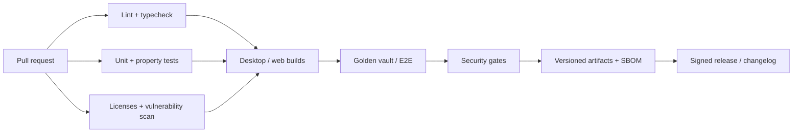

**Required guardrails:** pinned actions, minimum token permissions, CODEOWNERS, branch protection, secret scanning, provenance and reproducible build documentation. Do not run untrusted PR scripts with production publishing credentials.

### 19.3 Versioning and upgrade strategy

- Desktop app SemVer, schema `schemaVersion`, explicit migration runners.
- Metadata schema migrations are transactional and backed up.
- Stable `plugin-sdk` version and compatibility range in manifests.
- Preserve canonical file formats even if internal database migrations fail.
- Test opening old vault metadata with new versions and recovery after interrupted upgrades.

### 19.4 Open-source governance

**Apache-2.0** recommendation: permissive ecosystem contribution, redistribution and an explicit patent license; verify name/trademark and contributor policy separately. Include `CONTRIBUTING.md`, `CODE_OF_CONDUCT.md`, `SECURITY.md`, `GOVERNANCE.md`, `ROADMAP.md`, license headers and a public RFC/ADR mechanism. Decide branding/trademark permissions independently from code licensing.

---

## 20. 💸 Cost, Hosting and Sustainability

### 20.1 Separate cost centers

| Feature | Offline/self-host baseline | Potential variable cloud cost |
|---|---|---|
| Local notes and graph | User's disk and CPU | None to project |
| Semantic embeddings | Local model or BYO key | External embedding tokens if selected |
| Hosted chat/agents | Not required | Model input/output tokens, tool calls |
| Sync | DIY Git/WebDAV/S3 adapter | Object storage, bandwidth, API calls, support |
| Publishing | Static export / GitHub Pages | Build minutes, CDN, hosting, domains |
| Collaboration | Disabled initially | WebSocket/concurrency, persistence, egress |
| OCR/transcription | Local optional tools | Cloud inference if selected |
| Telemetry | Local traces | Optional collector/storage |

### 20.2 Pricing philosophy

A product inspired by Obsidian's ~$4 sync and ~$8 publish **does not need to clone those prices**, which can change and may not cover AI costs. Recommended value proposition: **free and complete local core**, free self-host tools, BYO model keys, optional managed services priced on real usage. Managed AI usage should be separately metered or capped, because unbounded model requests can overwhelm a low flat subscription price.

### 20.3 Suggested future service tiers (hypotheses only)

- **Community:** local core, self-host, vault import, static export, BYO AI models; free.
- **Personal convenience:** managed encrypted sync, simple publish automation, device management; price validated after operations tests.
- **Creator/Team:** collaboration, custom domains, team controls, hosted semantic search; usage-aware pricing.

### 20.4 Unit economics workbook fields

`monthly_active_users × average_vault_size × storage_replication_factor`, `monthly_sync_GB`, `builds/user`, `build_minutes`, `read/write requests`, `AI input/output tokens`, `embedding refresh rate`, `support tickets`, `fraud/abuse budget`, `payment fees`, `gross margin`. Do not quote per-user cloud costs until real workloads and cloud region/pricing are chosen.

---

## 21. 🗓️ Roadmap, Sequencing & Delivery Dependencies

### 21.1 Why this order

Start with **file integrity** because every other feature depends on trustworthy canonical content. Build graph and FTS before RAG so AI can leverage deterministic retrieval. Add agent write proposals only after reliable revision/diff transactions. Add MDX and plugins only after sandbox capability isolation. Add sync only after revision and merge invariants are proven.

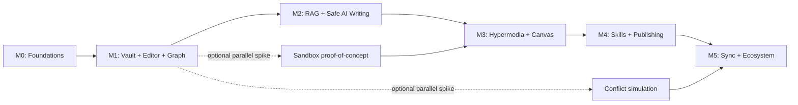

### 21.2 Milestone definitions

| Milestone | Deliverable | Exit gate |
|---|---|---|
| **M0 · Architecture spike** | Tauri shell, themes, basic file IO, threat model, dependency/license review | Cross-OS smoke; no privileged renderer shortcuts |
| **M1 · Knowledge Alpha** | Copy import, editor, autosave, backlinks, graph, FTS, rename, backups | Golden vault suite; recoverability tests |
| **M2 · Intelligence Alpha** | Retrieval, citations, local/hosted model adapters, patch proposals | Citation verifier and zero unauthorized writes |
| **M3 · Creative Beta** | Trust-tiered MDX/HTML, Mermaid, canvas, interactive safe components | Renderer isolation and graph/canvas consistency |
| **M4 · Agent & Publish Beta** | Skill registry, scoped tools/MCP, run log, Astro export, deployment preview | Publish privacy suite and capability review |
| **M5 · Portable Ecosystem** | Personal encrypted sync, extension SDK, stable installer/release | Conflict matrix, key recovery and migration tests |
| **Later** | Collaboration, web editor, mobile, shared workspaces, marketplace | Separate security/operations RFC |

### 21.3 Example implementation order for Code Assist

**Work package 0 — Foundations**

1. Define schemas for `Vault`, `Document`, `Revision`, `CapabilityGrant`, `PatchProposal`, `SourceCitation`.
2. Scaffold monorepo and UI shell; implement design tokens and dockable-pane state.
3. Create Rust vault read/write abstraction and typed frontend IPC; enforce path scopes.
4. Add transactional file writer, watcher, content hashes and SQLite migrations.
5. Build golden vault fixtures and CI for macOS/Windows/Linux.

**Work package 1 — Obsidian compatibility**

1. Write parser adapters for YAML frontmatter, wiki links, headings, block refs, embeds and callouts.
2. Implement vault scan/compatibility report, import copy mode and rollback.
3. Implement stable document IDs, link resolver and rename transaction.
4. Add CodeMirror editing, preview, file explorer and stacked tabs.
5. Build FTS index, links/backlinks graph, tags and source highlighting.

**Work package 2 — Intelligence**

1. Implement chunk source maps and embedding adapters.
2. Build retrieval and citation resolution APIs; hybrid query and filtering.
3. Add provider adapters with explicit prompt/consent boundaries.
4. Build read-only question-answer flow with citation test suite.
5. Add patch proposal DTO, diff viewer, CAS commit, event journal and reindexing.

**Work package 3 — Creation**

1. Add MDX trust tiers and isolated preview proof-of-concept.
2. Add Mermaid and approved widget registry.
3. Build React Flow semantic canvas and import/export scene files.
4. Add graph-to-canvas reference operations and editable node linking.
5. Add HTML/JS sandbox UX and permission review.

**Work package 4 — Agents and publish**

1. Build durable agent state machine, cancellation and budget enforcement.
2. Build skill manifest registry, MCP gateway and capability broker.
3. Add code/article generation with evidence-aware proposals.
4. Build static export pipeline to Astro and staging checks.
5. Add GitHub Pages or local-static export adapter and deployment receipts.

**Work package 5 — Sync, SDK and hardening**

1. Prototype sync manifest protocol, encrypted object transport and conflict resolution.
2. Run concurrent offline conflict matrix and key recovery tests.
3. Stabilize extension SDK and capability scopes.
4. Create contributor examples, docs, signatures and release pipeline.
5. Beta audit, accessibility pass, packaging and migration support.

### 21.4 Prioritization rule

Do not begin the next milestone before its data-loss and security exit gates pass. Opportunistic visual polish is fine in parallel; architectural shortcuts that invalidate user trust are not.

---

## 22. 📋 Architecture Decision Records (ADRs)

| ADR | Decision | Why | Status |
|---|---|---|---|
| ADR-001 | Desktop-first, Tauri 2 | Local file access with controlled IPC | Proposed |
| ADR-002 | Markdown files as canonical knowledge | Portability and user ownership | **Recommended invariant** |
| ADR-003 | SQLite + FTS5 + relational graph projection | Low cost, offline, queryable, reconstructable | Proposed |
| ADR-004 | Hybrid retrieval; vectors optional | Exact and semantic searches both matter | Proposed |
| ADR-005 | Patch-first agent writes | Auditability and conflict prevention | **Recommended invariant** |
| ADR-006 | Renderer trust tiers + isolated execution | Arbitrary MDX/JS cannot share privileged UI origin | **Recommended invariant** |
| ADR-007 | Astro static export | Portable and efficient publishing | Proposed |
| ADR-008 | Per-file sync initially, CRDT collaboration later | Preserve plain files and avoid conflicting writers | Proposed |
| ADR-009 | Apache-2.0 licensing | Permissive ecosystem | Pending review |
| ADR-010 | Modular monolith with isolated workers | Minimize operational footprint | Proposed |
| ADR-011 | Explicit public-content manifest | Privacy and safe transclusion | **Recommended invariant** |
| ADR-012 | Provider-neutral AI model adapter | Optional, replaceable intelligence | **Recommended invariant** |
| ADR-013 | Knowledge Packs are signed Markdown, installed read-only; reader overlays live in the reader's vault | Portability, safe updates, no lock-in | Proposed |
| ADR-014 | Static, signed registry protocol; managed registry optional | Institutions and offline use without accounts | **Recommended invariant** |
| ADR-015 | Pack `aiPolicy` enforced before model context | Publisher rights and reader trust | **Recommended invariant** |
| ADR-016 | Rust backend everywhere; TypeScript frontend | Speed, memory safety, one codebase for desktop/server/cloud | **Accepted direction** |
| ADR-017 | Rust domain types are the source of truth; TS bindings, OpenAPI, JSON Schemas generated | No contract drift across the language boundary | Proposed |
| ADR-018 | One service layer, three hosts (Tauri, Axum self-host, Lambda) | Identical authorization everywhere; self-host stays open | Proposed |
| ADR-019 | Markdown semantics parsed only in Rust | One meaning for links, chunks, citations | Proposed |
| ADR-020 | Scripts and queries sandboxed in Rust (WASM first), own vault only, under grants | SilverBullet-style power without zone-3 risk | Proposed |
| ADR-021 | Learn from AGPL/GPL tools by design only; Pandoc only as optional external tool | Apache-2.0 hygiene | **Recommended invariant** |
| ADR-022 | Rust language server (`chitkala-lsp`) so vaults work in VS Code, Zed, Neovim | Foam lesson: meet writers in their editor | Proposed |
| ADR-023 | Vault exposed to external agents via MCP; reads by grant, writes only as patch proposals | OpenKnowledge lesson, with CHITKALA's safety model | Proposed |
| ADR-024 | Exports, publishing and packs add link reference definitions for wikilinks | Foam lesson: links work on GitHub and in other tools | Proposed |

> [!note] Prior art
> Lessons from Foam (closest to Obsidian), SilverBullet, Logseq, OpenKnowledge, Zettlr, Trilium, Joplin, SiYuan and
> AppFlowy, and the full Rust/TypeScript split, are in
> [`CHITKALA_PRIOR_ART_AND_STACK.md`](CHITKALA_PRIOR_ART_AND_STACK.md).

### 22.1 Major open technical decisions requiring spikes

1. **Vault indexing location:** inside vault versus OS appdata, with portable multi-machine restore behavior.
2. **Document stable IDs:** opt-in frontmatter modification versus resilient sidecar mapping.
3. **Rich editing:** source-first indefinitely, or bidirectional visual editor with lossless round trip.
4. **Browser edition:** File System Access API support versus remote-first workspace storage.
5. **Renderer sandbox:** iframe isolation with dedicated origin versus separately packaged preview process.
6. **Embedding storage:** sqlite-vec experimental adapter versus stable standalone local vector index.
7. **Sync protocol:** selected transport and encryption/key recovery UX.
8. **Licensing/brand:** code license, trademark, plugin marketplace policy, dependency notices.
9. **Model routing:** what data may be sent to each provider and what is cached.
10. **Managed hosting:** optional service boundaries, multi-tenant risk, support model.

---

## 23. 🧠 Future Extensions & Ecosystem Connections

### 23.1 Vichara integration

Vichara could remain an independently published ideation/research repository while CHITKALA indexes it as a vault, opens project documentation, renders Mermaid, resolves references and proposes updates through scoped repository tools. It should remain possible to use Vichara without CHITKALA.

### 23.2 Ananke integration

Ananke may provide deeper spec-driven, architecture-aware agent development. Define interoperability via a `TaskManifest`, `ArtifactManifest`, `EvidenceBundle`, `PolicyDecision` and `PatchBundle`. CHITKALA does not need to absorb Ananke's internal implementation to benefit from its outputs.

### 23.3 Future optional module families

| Working module name | Role | Core or plugin? |
|---|---|---|
| Chitkala Library | Durable documents and metadata | Core |
| Chitkala Anvaya | Knowledge graph and relationships | Core UI / extended semantics plugin |
| Chitkala Smriti | Retrieval and versioned memory | Core interface / vector plugin |
| Chitkala Kalpana | Visual creative workspace | Core canvas / extra renderers |
| Chitkala Kriya | Agent workflows and skills | Core broker / plugin runtime |
| Chitkala Prakasha | Publishing | First-party optional package |
| Chitkala Sankalpa | Planning and goals | Optional domain package |
| Chitkala Vimarsha | Research, review and synthesis | Agent template library |

These are internal naming proposals, **not** verified unique trademarks or package names.

---

## 24. ✅ Acceptance Scenarios for the Initial Public Alpha

### Scenario A — Safe import

**Given** an existing Obsidian vault with 10,000 Markdown files, linked attachments, frontmatter and plugin-dependent snippets, **when** a user scans and imports to a new CHITKALA workspace, **then** the source directory remains unmodified, each imported file has matching byte checksum (except explicitly selected conversions), every unresolved link is reported, and documents can be opened offline.

### Scenario B — Linked research

**Given** a document with `[[RAG Retrieval Strategies#Hybrid Search]]`, **when** it is indexed, **then** target resolution is stable after a filename rename and the backlink appears on the referenced section or document.

### Scenario C — Grounded answer

**Given** several documents about RAG, **when** a user asks for a comparison of embedding strategies, **then** retrieval combines exact and semantic signals and the answer includes clickable citations to existing passages; unsupported claims are identified as uncertain rather than assigned fake references.

### Scenario D — Agent-authored article

**Given** a user selects a research question and source folders, **when** a writer agent completes its task, **then** it produces an article and evidence-backed patch preview; before approval, no canonical file changes. After approval, a committed revision appears in the vault, graph, and search index with provenance.

### Scenario E — Malicious imported script

**Given** an `.mdx` note containing executable JavaScript that attempts to read private vault files, **when** it is previewed without elevated trust, **then** no privileged API is exposed and the user sees a safe preview or a clear blocked-content notice.

### Scenario F — Safe public publishing

**Given** a public article transcludes a private note, **when** a publish preview is built, **then** the private dependency is excluded or the build fails with a visible diagnostic. No private title/content enters generated HTML, search index, graph or static assets.

### Scenario G — Offline conflicting writes

**Given** the same Markdown document is edited independently on two offline devices, **when** sync resumes, **then** the system detects divergence, preserves both changes, and either performs a conflict-free proven merge or presents a conflict document and resolution interface. There is no silent last-writer-wins data loss.

### Scenarios H–N — Textbooks and Knowledge Packs

See [`CHITKALA_KNOWLEDGE_PACKS_AND_TEXTBOOKS.md` §16](CHITKALA_KNOWLEDGE_PACKS_AND_TEXTBOOKS.md#16-acceptance-scenarios):
build a textbook, install and read offline, keep notes across an edition update, honour a publisher's AI policy,
deliver a safety-critical erratum, partially install a huge repository, reject a tampered pack.

---

## 25. 🗺️ Immediate Action Plan (First Engineering Iteration)

**Deliver a thin vertical slice, not just UI screenshots.**

1. Create the monorepo and Tauri/React app shell with Aurora, Parchment and Atlas tokens.
2. Implement `VaultService.open`, `DocumentService.read`, `DocumentService.writeAtomic` and `DocumentService.list`.
3. Build CodeMirror source editor, safe Markdown preview, persisted tabs and left-hand file explorer.
4. Implement SQLite migrations, document hash ledger, FTS5 search and deterministic backlinks.
5. Use a 500-note fixture plus a real-vault copy to validate editor correctness, indexing and path handling.
6. Wire source-grounded read-only search Q&A through a mock model, then an optional local provider.
7. Add patch proposal, review and compare-and-swap commit before any autonomous writing behavior.
8. Write ADR outcomes and benchmark reports as Markdown within the project itself.

**First demo acceptance:** open an imported note → follow two links → ask a question → receive an answer with citations → request a draft section → approve a diff → see updated backlinks and search results. This demonstrates the distinctive value of CHITKALA without the complexity of collaboration, billing or cloud infrastructure.

---

## 26. 📚 Research References & Validation Notes

These are primary/reference sources used to validate important technology and policy decisions **as of the document date**. They do not imply all components are currently integrated or that pricing/version details are frozen.

1. [Tauri 2 filesystem and permission scopes](https://v2.tauri.app/plugin/file-system/) — scope-based access and safe API usage.
2. [Tauri plugin permission model](https://v2.tauri.app/learn/security/using-plugin-permissions/) — least-privilege desktop application design.
3. [Yjs document updates](https://docs.yjs.dev/api/document-updates) — CRDT update properties.
4. [Yjs offline support](https://docs.yjs.dev/getting-started/allowing-offline-editing) — IndexedDB and provider persistence patterns.
5. [SQLite FTS5](https://sqlite.org/fts5.html) — lexical indexing, ranking and snippet APIs.
6. [sqlite-vec README](https://github.com/asg017/sqlite-vec) — embedded vector approach with explicit pre-v1 warning.
7. [MDX getting started](https://mdxjs.com/getting-started/) — MDX compilation to JavaScript.
8. [Astro content collections](https://docs.astro.build/en/guides/content-collections/) — content pipeline.
9. [Astro MDX](https://docs.astro.build/en/guides/integrations-guide/mdx/) — MDX in publication.
10. [React Flow repository](https://github.com/xyflow/xyflow) — maintained MIT-licensed flow editor.
11. [Excalidraw repository](https://github.com/excalidraw/excalidraw) — MIT-licensed whiteboard.
12. [tldraw licensing](https://tldraw.dev/sdk-features/license-key) — production SDK license constraints.
13. [OWASP LLM security](https://owasp.org/projects/top-10-for-large-language-model-applications) — prompt injection, data exfiltration and excessive agency risks.
14. [OWASP MCP security cheat sheet](https://cheatsheetseries.owasp.org/cheatsheets/MCP_Security_Cheat_Sheet.html) — secure agent tool integrations.

---

## Appendix A — Glossary

| Term | Meaning in CHITKALA |
|---|---|
| Vault | User-owned local directory of source documents and attachments |
| Document | Identified, versioned note or structured content file |
| Revision | Committed content state with hash and change provenance |
| Chunk | Addressable source passage for search/retrieval |
| Explicit link | User-authored wikilink or Markdown link |
| Semantic edge | Typed concept relationship, with provenance and trust level |
| Agent run | A constrained, auditable invocation of an autonomous or assisted workflow |
| Skill | Versioned reusable instruction/workflow descriptor with declared capabilities |
| Tool | Callable action implemented by a trusted/brokered interface |
| Patch | Proposed source modification with revision precondition |
| Capability grant | Principal/action/resource/time-bound authorization |
| Publish manifest | Explicit allowlist and build options for public content |
| Local-first | Local content and core capabilities remain usable without internet |
| E2EE | End-to-end encryption of content under the intended threat model |
| CRDT | Convergent data structure for concurrent collaborative changes |

## Appendix B — Final architectural north star

> **CHITKALA** is a portable, permissioned environment where **knowledge remains human-owned, intelligence remains explainable, and automation remains reversible**.
>
> It must always be possible to turn off the AI, unplug the network, uninstall the application, and still possess useful, readable knowledge files.

**End of technical design — version 1.0 draft.**
